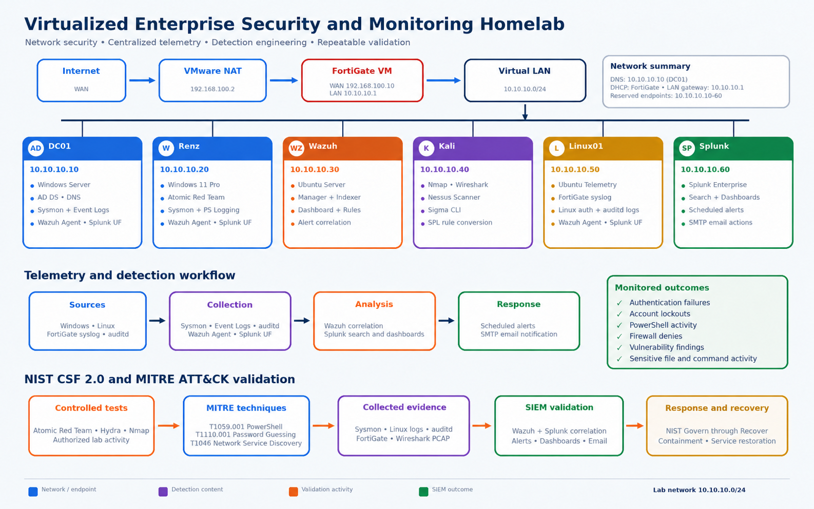

# Virtualized Enterprise Security and Monitoring Homelab

A multi-host enterprise security homelab built with VMware Workstation, FortiGate, Active Directory, Wazuh, Splunk Enterprise, Kali Linux, Nessus, Sysmon, auditd, Atomic Red Team, and Sigma.

The environment simulates SOC monitoring, centralized telemetry, firewall administration, identity security, vulnerability assessment, detection engineering, alerting, incident investigation, containment, recovery, and repeatable NIST CSF 2.0 and MITRE ATT&CK validation.

## Architecture



| System | Address | Role |
|---|---:|---|
| FortiGate VM | `10.10.10.1` | LAN gateway, DHCP, firewall, NAT and syslog source |
| DC01 | `10.10.10.10` | Windows Server, AD DS, DNS, Sysmon, Wazuh agent and Splunk Universal Forwarder |
| Renz | `10.10.10.20` | Windows 11 endpoint, Sysmon, PowerShell logging, Atomic Red Team and SIEM agents |
| Wazuh | `10.10.10.30` | Manager, indexer, dashboard, correlation and endpoint alerting |
| Kali Linux | `10.10.10.40` | Nmap, Wireshark, Nessus, Hydra and Sigma CLI |
| Linux01 | `10.10.10.50` | Ubuntu telemetry host, auditd, FortiGate syslog receiver, Wazuh agent and Splunk Universal Forwarder |
| Splunk Enterprise | `10.10.10.60` | Central search, dashboards, scheduled alerts and SMTP email actions |

### Network design

- VMware NAT network: `192.168.100.0/24`
- VMware NAT gateway: `192.168.100.2`
- FortiGate WAN: `192.168.100.10/24`
- Security lab LAN: `10.10.10.0/24`
- FortiGate LAN gateway: `10.10.10.1`
- Internal DNS: `10.10.10.10`
- DHCP and reserved endpoint assignments managed by FortiGate

## Implemented capabilities

### Network and identity services

- FortiGate firewalling, NAT, DHCP, routing and local/forward traffic logging
- Windows Server Active Directory Domain Services and internal DNS
- Windows 11 domain client and centralized account administration
- Network segmentation between the VMware WAN and security lab LAN

### Telemetry and SIEM

- Windows Security, System, Application and PowerShell Operational event collection
- Sysmon process, network and security telemetry
- Linux authentication and system logging
- Linux auditd rules for identity files, sudo/SSH configuration, process execution and file deletion
- FortiGate syslog collection through Linux01
- Splunk Universal Forwarders on Windows and Linux endpoints
- Wazuh agents on Windows and Linux endpoints
- Splunk dashboards, Wazuh threat hunting, scheduled alerts and SMTP email notifications

### Detection and investigation

- Windows and Linux successful and failed authentication monitoring
- SSH password-guessing and brute-force detection
- Windows account lockout and privileged group membership monitoring
- Active Directory account creation, modification, enable, disable and deletion events
- PowerShell and Sysmon process investigation
- Windows service installation monitoring
- Linux sudo, SSH, command execution and file-deletion activity
- FortiGate denied traffic and local-in traffic analysis
- Forwarder and Wazuh agent health monitoring
- Nessus vulnerability scanning and remediation evidence
- Source/destination IP, user, host, port and timeline correlation

## Detection engineering and validation

### Atomic Red Team and Sigma

- Executed a controlled Atomic Red Team PowerShell test mapped to `T1059.001`
- Verified Sysmon and PowerShell telemetry in Splunk
- Authored a Sigma rule and converted it to Splunk SPL
- Validated matching events, dashboard results, alerts and email workflow

### NIST CSF 2.0 and MITRE ATT&CK exercises

Each exercise documents authorization, assets, protection controls, detection, investigation, containment, recovery, lessons learned, reusable searches and supporting evidence.

| Exercise | ATT&CK mapping | Evidence |
|---|---|---|
| [SSH Brute Force Detection](tests/T1110-ssh-brute-force-detection/NIST-MITRE-SSH-Brute-Force-Detection.md) | `T1110`, `T1110.001` | Hydra output, Linux auth logs, Wazuh, Splunk, alert, email, containment and recovery |
| [Network Service Discovery](tests/T1046-network-service-discovery/NIST-MITRE-Nmap-Network-Service-Discovery.md) | `T1046` | Nmap output, Wireshark PCAP, Linux kernel logs, Wazuh, Splunk, FortiGate, alert, email, containment and recovery |
| PowerShell Execution Validation | `T1059.001` | Atomic Red Team, Sysmon, PowerShell logging, Sigma and Splunk SPL |

## Completed response workflows

### SSH password guessing

1. Generated a bounded password-guessing test from Kali using a fictional account.
2. Verified failed SSH events in Linux authentication logs.
3. Correlated the source IP, destination IP, user and attempt count in Wazuh and Splunk.
4. Triggered a Splunk alert after the configured threshold.
5. Received an SMTP email notification.
6. Temporarily contained the source IP.
7. Removed containment and verified successful SSH recovery.

### Network service discovery

1. Performed a controlled Nmap SYN and version-detection scan.
2. Captured and analyzed packets with tcpdump and Wireshark.
3. Logged scan packets with a temporary Linux firewall logging rule.
4. Investigated the activity in Wazuh and Splunk.
5. Collected FortiGate local-in traffic evidence by scanning the firewall interface.
6. Triggered a T1046 Splunk alert and email notification.
7. Tested source-IP containment and restored normal connectivity.

## Repository structure

```text
.
├── README.md
├── assets/
│   └── topology.png
├── docs/
│   ├── architecture.md
│   ├── vmware-network.md
│   ├── fortigate-configuration.md
│   ├── firewall-policies.md
│   ├── active-directory.md
│   ├── windows-client.md
│   ├── wazuh-configuration.md
│   ├── splunk-configuration.md
│   └── sysmon-telemetry.md
├── screenshots/
│   ├── Fortigate/
│   ├── Nessus/
│   ├── Splunk/
│   ├── active-directory/
│   ├── testing/
│   ├── vmware/
│   ├── wazuh/
│   └── windows-client/
└── tests/
    ├── T1110-ssh-password-guessing/
    │   ├── NIST-MITRE-SSH-Brute-Force-Detection.md.txt
    │   └── screenshots/
    └── T1046-network-service-discovery/
        ├── NIST-MITRE-Nmap-Network-Service-Discovery.md.txt
        ├── splunk-searches.spl.txt
        ├── wazuh-queries.txt.txt
        ├── nmap-results/
        │   ├── T1046-linux01.gnmap
        │   ├── T1046-linux01.nmap
        │   └── T1046-linux01.xml
        ├── packet-captures/
        └── screenshots/
```

## Screenshots

Browse the [screenshots folder](screenshots/) for visual evidence of the homelab setup and testing:

- [FortiGate](screenshots/Fortigate/)
- [Nessus](screenshots/Nessus/)
- [Splunk](screenshots/Splunk/)
- [Active Directory](screenshots/active-directory/)
- [Testing](screenshots/testing/)
- [VMware](screenshots/vmware/)
- [Wazuh](screenshots/wazuh/)
- [Windows client](screenshots/windows-client/)

Exercise-specific evidence is also organized in the `screenshots/` folders under `tests/`.

## Evidence standards

The repository contains sanitized evidence only. Passwords, application passwords, API tokens, private keys, cookies and other secrets are excluded. PCAP files are provided as downloadable binary evidence, with Wireshark screenshots included for visual review.

## Skills demonstrated

- SOC monitoring and SIEM investigation
- Windows and Linux administration
- Active Directory and DNS administration
- Firewall configuration and traffic analysis
- Log onboarding and field extraction
- Splunk SPL and dashboard creation
- Wazuh threat hunting and rule validation
- Detection engineering with Sigma and Atomic Red Team
- NIST CSF 2.0 and MITRE ATT&CK mapping
- Vulnerability assessment with Nessus
- Packet analysis with Wireshark
- Incident containment, recovery and technical documentation

## Disclaimer

All security testing documented in this repository was conducted only against privately owned and authorized virtual machines in an isolated homelab. The material is intended for defensive security education and portfolio demonstration.
