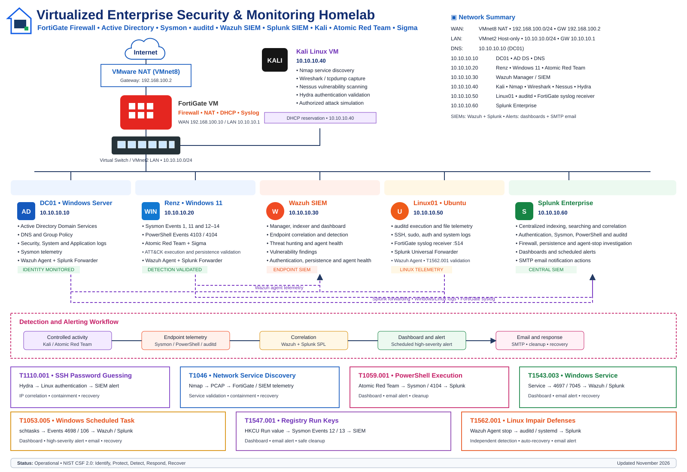

# Virtualized Enterprise Security and Monitoring Homelab

A multi-host enterprise security homelab built with VMware Workstation, FortiGate, Active Directory, Wazuh, Splunk Enterprise, Kali Linux, Nessus, Sysmon, auditd, Atomic Red Team and Sigma.

The environment simulates SOC monitoring, centralized telemetry, firewall administration, identity security, vulnerability assessment, detection engineering, alerting, incident investigation, containment, recovery and repeatable NIST CSF 2.0 and MITRE ATT&CK validation.

## Architecture



| System | Address | Role |
|---|---:|---|
| FortiGate VM | `10.10.10.1` | LAN gateway, DHCP, firewall, NAT and syslog source |
| DC01 | `10.10.10.10` | Windows Server, AD DS, DNS, Sysmon, Wazuh agent and Splunk Universal Forwarder |
| Renz | `10.10.10.20` | Windows 11 endpoint, Sysmon registry/process telemetry, PowerShell and Task Scheduler logging, Atomic Red Team, Sigma and SIEM agents |
| Wazuh | `10.10.10.30` | Manager, indexer, dashboard, correlation and endpoint alerting |
| Kali Linux | `10.10.10.40` | Nmap, Wireshark, Nessus, Hydra and validation tooling |
| Linux01 | `10.10.10.50` | Ubuntu telemetry host, auditd, FortiGate syslog receiver, Wazuh agent and Splunk Universal Forwarder |
| Splunk Enterprise | `10.10.10.60` | Central search, dashboards, scheduled alerts and SMTP email actions |

### Network design

- VMware NAT network: `192.168.100.0/24`
- VMware NAT gateway: `192.168.100.2`
- FortiGate WAN: `192.168.100.10/24`
- Security lab LAN: `10.10.10.0/24`
- FortiGate LAN gateway: `10.10.10.1`
- Internal DNS: `10.10.10.10`
- DHCP and endpoint reservations managed by FortiGate

## Implemented capabilities

### Network and identity

- FortiGate firewalling, NAT, DHCP, routing and traffic logging
- Windows Server Active Directory Domain Services and internal DNS
- Windows 11 domain client and centralized account administration
- VMware WAN and host-only security-lab segmentation

### Telemetry and SIEM

- Windows Security, System, Application, PowerShell Operational and Task Scheduler Operational event collection
- Sysmon process, network, registry and file telemetry
- Linux authentication, system and auditd logging
- FortiGate syslog collection through Linux01
- Splunk Universal Forwarders and Wazuh agents on Windows and Linux endpoints
- Splunk dashboards, Wazuh threat hunting, scheduled alerts and SMTP notifications

### Detection and investigation

- Windows and Linux authentication monitoring
- SSH password-guessing and brute-force detection
- Windows account lockout, account lifecycle and privileged-group monitoring
- PowerShell and Sysmon process investigation
- Windows service-installation monitoring
- Windows scheduled-task creation and deletion monitoring
- Windows Registry Run-key persistence monitoring
- Linux sudo, SSH, execution and file-deletion activity
- FortiGate denied and local-in traffic analysis
- Nessus vulnerability scanning and remediation evidence
- Source IP, destination IP, user, host, port and timeline correlation

## Detection engineering and validation

- Executed controlled Atomic Red Team tests mapped to MITRE ATT&CK
- Authored Sigma detections and converted them to Splunk SPL
- Validated Sysmon Event IDs `1`, `11` and `12-14`
- Validated PowerShell Operational Event IDs `4103` and `4104`
- Validated Windows service installation through Security Event `4697`, System Event `7045` and related Sysmon telemetry
- Validated scheduled-task activity through Security Events `4698`/`4699`, Task Scheduler Events `106`/`141` and Sysmon process creation
- Validated Registry Run-key persistence through Sysmon Events `12` and `13`, Wazuh threat hunting and Splunk correlation
- Built Splunk investigations, dashboards, scheduled alerts and email notifications
- Documented cleanup, containment, recovery and lessons learned

## NIST CSF 2.0 and MITRE ATT&CK exercises

| Exercise | ATT&CK mapping | Evidence |
|---|---|---|
| [SSH Brute Force Detection](tests/T1110-ssh-password-guessing/NIST-MITRE-SSH-Brute-Force-Detection.md) | `T1110`, `T1110.001` | Hydra, Linux authentication logs, Wazuh, Splunk, email, containment and recovery |
| [Network Service Discovery](tests/T1046-network-service-discovery/NIST-MITRE-Nmap-Network-Service-Discovery.md) | `T1046` | Nmap, PCAP, Linux, Wazuh, Splunk, FortiGate, email, containment and recovery |
| [PowerShell Execution Validation](tests/T1059-001-powershell-execution-validation/NIST-MITRE-PowerShell-Execution-Validation.md) | `T1059.001` | Atomic Red Team, Sysmon, PowerShell logging, Splunk correlation, dashboard, alert, email and cleanup |
| [Windows Service Creation](tests/T1543-003-windows-service-creation/NIST-MITRE-Windows-Service-Creation.md) | `T1543.003` | Controlled service installation, Events 4697/7045, Sysmon, Wazuh, Splunk, dashboard, email and recovery |
| [Windows Scheduled Task](tests/T1053-005-windows-scheduled-task/NIST-MITRE-Windows-Scheduled-Task.md) | `T1053.005` | Controlled task creation, Events 4698/106, Sysmon, Wazuh, Splunk dashboard, high-severity alert, email and recovery |
| [Registry Run Keys](tests/T1547-001-registry-run-keys/NIST-MITRE-Registry-Run-Keys.md) | `T1547.001` | Controlled HKCU Run-value creation, Sysmon Events 12/13, Wazuh, Splunk dashboard, high-severity alert, email and recovery |

## Completed response workflows

### SSH password guessing

1. Generated a bounded password-guessing test from Kali using a fictional account.
2. Verified failed SSH events in Linux authentication logs.
3. Correlated the source IP, destination IP, user and attempt count in Wazuh and Splunk.
4. Triggered a Splunk alert and SMTP email notification.
5. Contained the source and verified service recovery.

### Network service discovery

1. Performed a controlled Nmap SYN and version-detection scan.
2. Captured and analyzed packets with tcpdump and Wireshark.
3. Investigated related Linux, Wazuh, Splunk and FortiGate telemetry.
4. Triggered a T1046 Splunk alert and email notification.
5. Tested containment and restored connectivity.

### PowerShell execution validation

1. Established Sysmon and PowerShell telemetry baselines on the Windows 11 endpoint.
2. Reviewed and executed an authorized Atomic Red Team T1059.001 test.
3. Correlated process creation, script block, registry and file-creation telemetry in Splunk.
4. Created a dashboard panel and high-severity scheduled alert.
5. Verified the email workflow and removed the Atomic test artifacts.

### Windows service creation

1. Established Windows service and SIEM telemetry baselines on the Windows 11 endpoint.
2. Enabled service-installation auditing and created a harmless manual-start test service.
3. Validated Security Event `4697`, System Event `7045` and related Sysmon activity.
4. Correlated the service name, binary path, user, host and event timeline in Wazuh and Splunk.
5. Added a Splunk dashboard panel, high-severity scheduled alert and SMTP notification.
6. Removed the test service and verified service and registry-key recovery.

### Windows scheduled task

1. Enabled Other Object Access Events auditing and the Task Scheduler Operational log.
2. Established a scheduled-task baseline and created a harmless one-time test task.
3. Validated Security Event `4698`, Task Scheduler Event `106` and Sysmon `schtasks.exe` process telemetry.
4. Correlated the task name, event ID, process, command line, host and timestamp in Wazuh and Splunk.
5. Added a Splunk dashboard panel, high-severity scheduled alert and SMTP email notification.
6. Deleted the task, reviewed Events `4699`/`141`, and verified agent, forwarder and SIEM connectivity.

### Registry Run-key persistence

1. Established a baseline of `HKCU\Software\Microsoft\Windows\CurrentVersion\Run`.
2. Verified Sysmon registry telemetry with a temporary benign key.
3. Created a harmless Run value named `T1547.001-LabRunKey` pointing to `cmd.exe /c exit 0`.
4. Correlated Sysmon Event `13`, the process, user, registry target and value data in Wazuh and Splunk.
5. Added a Splunk dashboard panel, high-severity scheduled alert and SMTP email notification.
6. Removed only the test value, reviewed Sysmon deletion telemetry and verified endpoint and SIEM recovery.

## Documentation

- [Architecture](docs/architecture.md)
- [VMware network](docs/vmware-network.md)
- [FortiGate configuration](docs/fortigate-configuration.md)
- [Firewall policies](docs/firewall-policies.md)
- [Active Directory](docs/active-directory.md)
- [Windows client](docs/windows-client.md)
- [Wazuh configuration](docs/wazuh-configuration.md)
- [Splunk configuration](docs/splunk-configuration.md)
- [Sysmon telemetry](docs/sysmon-telemetry.md)
- [auditd configuration](docs/auditd-configuration.md)

## Repository structure

```text
.
├── README.md
├── assets/
│   ├── topology.png
│   └── topology.svg
├── docs/
│   ├── architecture.md
│   ├── vmware-network.md
│   ├── fortigate-configuration.md
│   ├── firewall-policies.md
│   ├── active-directory.md
│   ├── windows-client.md
│   ├── wazuh-configuration.md
│   ├── splunk-configuration.md
│   ├── sysmon-telemetry.md
│   └── auditd-configuration.md
├── screenshots/
│   ├── Fortigate/
│   ├── Nessus/
│   ├── Splunk/
│   ├── active-directory/
│   ├── testing/
│   ├── vmware/
│   ├── wazuh/
│   └── windows-client/
└── tests/
    ├── T1110-ssh-password-guessing/
    ├── T1046-network-service-discovery/
    │   ├── splunk-searches.spl
    │   └── wazuh-queries.txt
    ├── T1059-001-powershell-execution-validation/
    │   ├── NIST-MITRE-PowerShell-Execution-Validation.md
    │   ├── splunk-searches.spl
    │   └── screenshots/
    ├── T1543-003-windows-service-creation/
    │   ├── NIST-MITRE-Windows-Service-Creation.md
    │   ├── splunk-searches.spl
    │   ├── wazuh-queries.txt
    │   └── screenshots/
    │       ├── README.md
    │       └── 20 evidence screenshots
    ├── T1053-005-windows-scheduled-task/
    │   ├── NIST-MITRE-Windows-Scheduled-Task.md
    │   ├── splunk-searches.spl
    │   ├── wazuh-queries.txt
    │   └── screenshots/
    │       ├── README.md
    │       └── 20 evidence screenshots
    └── T1547-001-registry-run-keys/
        ├── NIST-MITRE-Registry-Run-Keys.md
        ├── splunk-searches.spl
        ├── wazuh-queries.txt
        └── screenshots/
            ├── README.md
            └── 15 evidence screenshots
```

## Evidence standards

Only sanitized evidence is published. Passwords, application passwords, API tokens, private keys, cookies and other secrets are excluded. Exercise evidence is organized inside each test folder, with reusable queries stored as text files.

## Skills demonstrated

- SOC monitoring and SIEM investigation
- Windows, Linux and Active Directory administration
- Firewall configuration and traffic analysis
- Log onboarding, field extraction and correlation
- Splunk SPL, dashboards, scheduled alerts and email actions
- Wazuh threat hunting and agent monitoring
- Detection engineering with Sigma and Atomic Red Team
- Windows service creation and persistence detection
- Windows scheduled-task persistence detection
- Windows Registry Run-key persistence detection
- NIST CSF 2.0 and MITRE ATT&CK mapping
- Vulnerability assessment and packet analysis
- Incident containment, recovery and technical documentation

## Disclaimer

All security testing documented in this repository was conducted only against privately owned and authorized virtual machines in an isolated homelab. The material is intended for defensive security education and portfolio demonstration.


