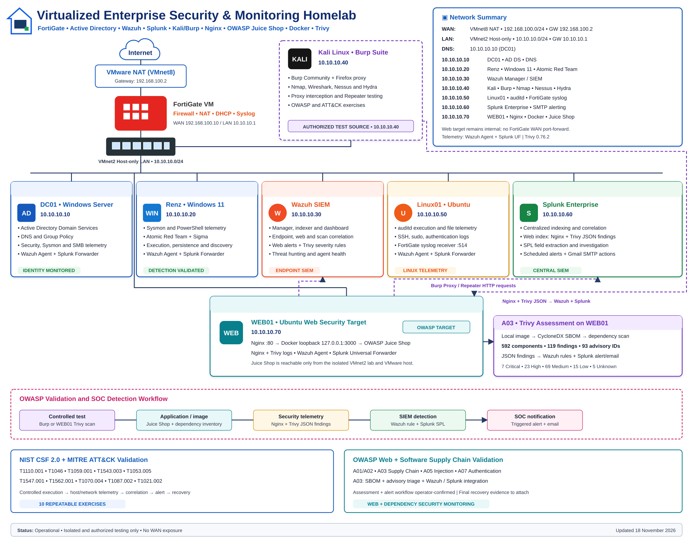

# Virtualized Enterprise Security and Monitoring Homelab

A multi-host enterprise security homelab built with VMware Workstation, FortiGate, Active Directory, Wazuh, Splunk Enterprise, Kali Linux, Nessus, Sysmon, auditd, Atomic Red Team, Sigma, Docker, Nginx, OWASP Juice Shop, Burp Suite Community Edition, Trivy and OpenSSL.

The environment simulates SOC monitoring, centralized telemetry, firewall administration, identity security, vulnerability assessment, detection engineering, alerting, incident investigation, containment, recovery and repeatable NIST CSF 2.0 and MITRE ATT&CK validation.

## Architecture

| System | Address | Role |
|---|---:|---|
| FortiGate VM | `10.10.10.1` | LAN gateway, DHCP, firewall, NAT and syslog source |
| DC01 | `10.10.10.10` | Windows Server, AD DS, DNS, Sysmon, SMB/File Share auditing, Wazuh agent and Splunk Universal Forwarder |
| Renz | `10.10.10.20` | Windows 11 domain endpoint, Sysmon process/network telemetry, PowerShell, Task Scheduler, Active Directory discovery, SMB validation and SIEM agents |
| Wazuh | `10.10.10.30` | Manager, indexer, dashboard, correlation and endpoint alerting |
| Kali Linux | `10.10.10.40` | Nmap, Wireshark, Nessus, Hydra, Burp and A08 artifact signing |
| Linux01 | `10.10.10.50` | Ubuntu telemetry host, auditd, FortiGate syslog receiver, Wazuh agent, Splunk Universal Forwarder and controlled agent-health validation |
| Splunk Enterprise | `10.10.10.60` | Central search, dashboards, scheduled alerts and SMTP email actions |
| WEB01 | `10.10.10.70` | Ubuntu web-security target with Nginx, Docker, OWASP Juice Shop, Wazuh Agent, Splunk Universal Forwarder and Trivy dependency assessment, authentication-transport, basket-quantity and signed-artifact verification telemetry |

### Network design

- VMware NAT network: `192.168.100.0/24`
- VMware NAT gateway: `192.168.100.2`
- FortiGate WAN: `192.168.100.10/24`
- Security lab LAN: `10.10.10.0/24`
- FortiGate LAN gateway: `10.10.10.1`
- Internal DNS: `10.10.10.10`
- DHCP and endpoint reservations managed by FortiGate
- Juice Shop is contained on WEB01 loopback port `3000`; Nginx is the only LAN-facing entry point on port `80`
- No WAN port-forward exposes the intentionally vulnerable web target

## Implemented capabilities

### Network and identity

- FortiGate firewalling, NAT, DHCP, routing and traffic logging
- Windows Server Active Directory Domain Services and internal DNS
- Windows 11 domain client and centralized account administration
- VMware WAN and host-only security-lab segmentation

### Telemetry and SIEM

- Windows Security, System, Application, PowerShell Operational and Task Scheduler Operational event collection
- Sysmon process, network, registry and file telemetry
- Linux authentication, system and auditd logging
- FortiGate syslog collection through Linux01
- Splunk Universal Forwarders and Wazuh agents on Windows and Linux endpoints
- Splunk dashboards, Wazuh threat hunting, scheduled alerts and SMTP notifications
- Dedicated WEB01 Nginx access/error telemetry forwarded to Wazuh and the Splunk `web` index
- Trivy findings normalized to JSON Lines, collected by Wazuh and Splunk with scan identifiers
- Separate Nginx JSON transport log with scheme, port, method, URI, status and validation markers
- Quantity-aware basket-update JSON collected by Wazuh and Splunk, excluding tokens and full request bodies
- Signature-verification JSON collected by Wazuh and Splunk with outcome, rejection reason, run ID and before/after artifact hashes

### Detection and investigation

- Windows and Linux authentication monitoring
- SSH password-guessing and brute-force detection
- Windows account lockout, account lifecycle and privileged-group monitoring
- PowerShell and Sysmon process investigation
- Windows service-installation monitoring
- Windows scheduled-task creation and deletion monitoring
- Windows Registry Run-key persistence monitoring
- Windows file creation and deletion monitoring through Sysmon Event `11` and Security Events `4663`/`4660`
- Active Directory account-discovery monitoring through Sysmon process creation and PowerShell script-block logging
- SMB network-logon and administrative-share monitoring through Events `4624`, `5140`, `5145` and Sysmon Event `3`
- Linux sudo, SSH, execution and file-deletion activity
- Linux security-agent interruption and recovery monitoring
- FortiGate denied and local-in traffic analysis
- Nessus vulnerability scanning and remediation evidence
- OWASP Juice Shop request inspection through Burp Suite Proxy, HTTP history and Repeater
- Exposed-directory and document-access monitoring for `/ftp/` resources
- Web authentication-failure monitoring, five-event threshold correlation and post-failure successful-login analysis
- Controlled SQL-injection testing of the Juice Shop product-search API with Burp Repeater
- Wazuh SQL-injection alert observed for a single-quote product-search request
- Trivy container/dependency assessment, CycloneDX SBOM generation and advisory applicability review
- Custom Wazuh Critical/High scanner-finding rules and Splunk alert/email validation
- HTTP authentication-transport assessment from Kali using Burp, curl and a scoped packet capture
- Wazuh rule `119991` for unencrypted login POSTs and Splunk transport-aware alert/email configuration
- A06 own-basket business-rule testing, Wazuh negative-quantity rule `119995` and scheduled Splunk detection
- OpenSSL RSA/SHA-256 artifact signing, trusted-key pinning and a verification gate before lab staging
- A08 Wazuh blocked-artifact rule `119997`, full-record JSON rule-conflict diagnosis and Splunk alert/email validation
- SMTP notification troubleshooting through scheduler and email-action logs
- Source IP, destination IP, user, host, port, URI, HTTP status and timeline correlation

## Detection engineering and validation

- Executed controlled Atomic Red Team tests mapped to MITRE ATT&CK
- Authored Sigma detections and converted them to Splunk SPL
- Validated Sysmon Event IDs `1`, `11` and `12-14`
- Validated PowerShell Operational Event IDs `4103` and `4104`
- Validated Windows service installation through Security Event `4697`, System Event `7045` and related Sysmon telemetry
- Validated scheduled-task activity through Security Events `4698`/`4699`, Task Scheduler Events `106`/`141` and Sysmon process creation
- Validated Registry Run-key persistence through Sysmon Events `12` and `13`, Wazuh threat hunting and Splunk correlation
- Validated Linux defense impairment by stopping the Wazuh Agent while auditd and Splunk remained active, then verifying automated recovery
- Validated controlled Windows file deletion using a SHA-256 baseline, scoped Object Access auditing, Security Events `4663`/`4660`, Wazuh review and Splunk correlation
- Validated domain-account discovery using `net user /domain`, `Get-ADUser`/ADSI, Sysmon Event `1`, PowerShell Event `4104`, Wazuh and Splunk
- Validated controlled SMB/IPC$ access from Renz to DC01 using network-logon, share-access and Sysmon network-connection telemetry
- Deployed OWASP Juice Shop behind Nginx on WEB01 with Docker loopback binding and dual Wazuh/Splunk telemetry
- Validated OWASP 2025 A01/A02 exposed-resource access through Burp Suite and correlated HTTP `200` responses in Nginx, Wazuh and Splunk
- Authored Wazuh web rules and a Splunk scheduled alert for `/ftp` directory or document access
- Validated OWASP 2025 A07 by replaying a bounded five-request HTTP `401` sequence and confirming the absence of rate limiting or temporary lockout
- Correlated repeated Juice Shop authentication failures with Wazuh rules `119972`/`119973` and a high-severity Splunk alert
- Assessed 592 detected components; recorded 119 package findings across 93 advisory IDs
- Investigated runtime package paths, PBKDF2 defaults, nested lodash function availability and JWT configuration
- Corrected Splunk event splitting and removed redundant JSON extraction from the final queries
- Reviewed A04 JSON logtest evidence matching Wazuh rule `119991` at level `10`
- Verified A04 recovery: healthy WEB01 services, loopback-only container, HTTP 200 and fresh Splunk collection
- Reviewed A06 quantity extraction and scheduled searches with matching results and email-action selection
- Diagnosed a temporary SMTP hostname-resolution failure during A06 notification validation
- Validated A08 approved-artifact staging and tampered-input rejection with unchanged active SHA-256
- Resolved Wazuh built-in `86600` routing by parenting the scoped A08 rules beneath the matched branch
- Completed A08 live-alert, received-email and known-good recovery workflow per operator confirmation
- Built Splunk investigations, dashboards, scheduled alerts and email notifications
- Documented cleanup, containment, recovery and lessons learned

## NIST CSF 2.0 and MITRE ATT&CK exercises

| Exercise | ATT&CK mapping | Evidence |
|---|---|---|
| [SSH Brute Force Detection](tests/T1110-ssh-password-guessing/NIST-MITRE-SSH-Brute-Force-Detection.md) | `T1110`, `T1110.001` | Hydra, Linux authentication logs, Wazuh, Splunk, email, containment and recovery |
| [Network Service Discovery](tests/T1046-network-service-discovery/NIST-MITRE-Nmap-Network-Service-Discovery.md) | `T1046` | Nmap, PCAP, Linux, Wazuh, Splunk, FortiGate, email, containment and recovery |
| [PowerShell Execution Validation](tests/T1059-001-powershell-execution-validation/NIST-MITRE-PowerShell-Execution-Validation.md) | `T1059.001` | Atomic Red Team, Sysmon, PowerShell logging, Splunk correlation, dashboard, alert, email and cleanup |
| [Windows Service Creation](tests/T1543-003-windows-service-creation/NIST-MITRE-Windows-Service-Creation.md) | `T1543.003` | Controlled service installation, Events 4697/7045, Sysmon, Wazuh, Splunk, dashboard, email and recovery |
| [Windows Scheduled Task](tests/T1053-005-windows-scheduled-task/NIST-MITRE-Windows-Scheduled-Task.md) | `T1053.005` | Controlled task creation, Events 4698/106, Sysmon, Wazuh, Splunk dashboard, high-severity alert, email and recovery |
| [Registry Run Keys](tests/T1547-001-registry-run-keys/NIST-MITRE-Registry-Run-Keys.md) | `T1547.001` | Controlled HKCU Run-value creation, Sysmon Events 12/13, Wazuh, Splunk dashboard, high-severity alert, email and recovery |
| [Linux Impair Defenses](tests/T1562-001-impair-defenses/NIST-MITRE-Linux-Impair-Defenses.md) | `T1562.001` | Controlled Wazuh Agent interruption, systemd and auditd evidence, independent Splunk detection, alert, email and recovery |
| [Windows File Deletion](tests/T1070-004-windows-file-deletion/NIST-MITRE-Windows-File-Deletion.md) | `T1070.004` | Controlled marker-file deletion, SHA-256 baseline, Events 4663/4660, Wazuh investigation, Splunk dashboard, alert, email and cleanup |
| [Domain Account Discovery](tests/T1087-002-domain-account-discovery/NIST-MITRE-Domain-Account-Discovery.md) | `T1087.002` | Native and PowerShell/ADSI account discovery, Sysmon Event 1, PowerShell Event 4104, Wazuh, Splunk dashboard, alert, email and recovery |
| [SMB/Windows Admin Shares](tests/T1021-002-smb-windows-admin-shares/NIST-MITRE-SMB-Windows-Admin-Shares.md) | `T1021.002` | Controlled IPC$ connection, Events 4624/5140/5145, Sysmon Event 3, source/destination correlation, Wazuh, Splunk dashboard, alert, email and cleanup |

## OWASP application and software supply chain exercises

| Exercise | OWASP mapping | Evidence |
|---|---|---|
| [Juice Shop exposed-resource detection](tests/owasp-top-10-2025/A01-A02-exposed-resources/OWASP-A01-A02-Exposed-Resources-Validation.md) | **A01:2025 Broken Access Control**, **A02:2025 Security Misconfiguration** | WEB01, Docker, Nginx, Burp Suite, exposed `/ftp/` resources, Wazuh custom rules, Splunk investigation, triggered alert and email notification |
| [Container and dependency assessment](tests/owasp-top-10-2025/A03-software-supply-chain/OWASP-A03-Software-Supply-Chain-Validation.md) | **A03:2025 Software Supply Chain Failures** | Trivy 0.76.2, CycloneDX SBOM, 592 components, 119 package findings / 93 advisories, applicability triage, custom Wazuh severity rules, Splunk ingestion and user-confirmed alert/email workflow |
| [HTTP authentication transport assessment](tests/owasp-top-10-2025/A04-cryptographic-failures/OWASP-A04-Cryptographic-Failures-Validation.md) | **A04:2025 Cryptographic Failures** | HTTP/HTTPS checks, scheme-aware JSON telemetry, Wazuh rule `119991`, Splunk alert/email configuration and reviewed recovery; HTTPS enforcement remains open |
| [Product-search SQL injection](tests/owasp-top-10-2025/A05-injection/OWASP-A05-SQL-Injection-Validation.md) | **A05:2025 Injection** | Completed: Boolean response comparison, Nginx/Splunk timeline, triggered alert and email, Wazuh rule `31164`, and recovery evidence |
| [Basket business-rule assessment](tests/owasp-top-10-2025/A06-insecure-design/OWASP-A06-Insecure-Design-Validation.md) | **A06:2025 Insecure Design** | Own-basket negative-quantity test and restoration (operator-confirmed), quantity-aware Nginx JSON, Wazuh `119995`, reviewed Splunk ingestion/scheduler evidence, notification troubleshooting; server validation remains open |
| [Authentication failure and rate-limit validation](tests/owasp-top-10-2025/A07-authentication-failures/OWASP-A07-Authentication-Failures-Validation.md) | **A07:2025 Authentication Failures** | Controlled HTTP `401` sequence, immediate post-failure `200`, Nginx, Wazuh rules `119972`/`119973`, Splunk threshold alert and SMTP notification |
| [Signed-artifact integrity validation](tests/owasp-top-10-2025/A08-software-data-integrity/OWASP-A08-Software-Data-Integrity-Validation.md) | **A08:2025 Software or Data Integrity Failures** | RSA/SHA-256 signing, pinned public key, modified-input rejection with unchanged staged hash, corrected Wazuh `119997`, scheduled Splunk alert, received email and recovery (operator-confirmed); screenshots pending upload |

### A03 container and dependency assessment

Trivy generated a CycloneDX 1.7 SBOM containing 592 detected components from
WEB01's deployed Juice Shop image. The baseline scan reported 119 package
findings across 93 advisory IDs: 7 Critical, 23 High, 69 Medium, 15 Low and
5 Unknown. Selected findings were checked against package metadata and source;
scanner matches were distinguished from demonstrated application exposure.

JSON findings were collected by Wazuh and Splunk. Wazuh Critical/High rules
passed logtest, and the operator confirmed live Wazuh alerts, the corrected
Splunk summary, and triggered-alert/email screenshot completion. A reusable
WEB01 test runs a fresh scan and forwards one actual priority finding with a
new test-run ID. The pre-integration health check was reviewed; the final
recovery captures have since been uploaded; their outcome review remains tracked in A03.

See the [A03 report](tests/owasp-top-10-2025/A03-software-supply-chain/OWASP-A03-Software-Supply-Chain-Validation.md)
and [evidence manifest](tests/owasp-top-10-2025/A03-software-supply-chain/screenshots/README.md)
for evidence status. The activity folder includes the validation report,
[Splunk searches](tests/owasp-top-10-2025/A03-software-supply-chain/splunk-searches.spl),
[Wazuh queries](tests/owasp-top-10-2025/A03-software-supply-chain/wazuh-queries.txt),
[Wazuh rules](tests/owasp-top-10-2025/A03-software-supply-chain/wazuh-rules.xml)
and screenshot checklist, matching the other OWASP activity folders.
A03 source captures have since been uploaded. Original scan-export availability and final recovery review remain tracked in its report.
No dependency patching or exploitation of dependency advisories is claimed.

### A04 authentication transport assessment

On 20 November 2026, Kali checked Juice Shop's HTTP/HTTPS behavior and generated
fictional login requests. HTTP served the application; the connection to port
443 failed before a TLS handshake. A separate Nginx JSON log now records scheme,
port, method, URI and status for Wazuh and Splunk.

The reviewed JSON event matched Wazuh rule `119991`, level `10`. The configured
Splunk alert runs every minute, groups matching HTTP login POSTs by source and
validation ID, and includes a contextual email message and inline results.
Subsequent uploads now verify the cleartext packet, live Wazuh alert, scheduled
Splunk trigger and received email. The trigger listing shows Digest mode; the
report distinguishes it from the guided per-result setting.

Recovery evidence confirms active application/agent services, the running
forwarder, Juice Shop's loopback binding, HTTP 200 with three products and a
fresh recovery GET indexed in Splunk. **HTTPS remediation remains open.**

See the [A04 report](tests/owasp-top-10-2025/A04-cryptographic-failures/OWASP-A04-Cryptographic-Failures-Validation.md),
[Splunk searches](tests/owasp-top-10-2025/A04-cryptographic-failures/splunk-searches.spl),
[Wazuh queries](tests/owasp-top-10-2025/A04-cryptographic-failures/wazuh-queries.txt),
[Wazuh rules](tests/owasp-top-10-2025/A04-cryptographic-failures/wazuh-rules.xml) and
[concise evidence checklist](tests/owasp-top-10-2025/A04-cryptographic-failures/screenshots/README.md).

### A05 product-search injection activity

Exercise 3 validated Boolean SQL injection against `GET /rest/products/search`:
the true condition returned products and the false condition returned an empty
array, both with HTTP 200. Nginx and Splunk recorded the requests. The A05
scheduled Splunk alert fired, and its email notification was received.

Wazuh rule `31164`, level `6`, flagged the encoded single-quote request as
"SQL injection attempt." The Boolean logtest matched rule `31100`, level
`0`; Boolean alert coverage is a documented detection gap. A normal search
returned products after testing and `nginx -t` succeeded. The uploaded recovery
capture does not establish every service's status or the post-test port binding.
See the [A05 report](tests/owasp-top-10-2025/A05-injection/OWASP-A05-SQL-Injection-Validation.md)
for the reviewed evidence and limitations.

### A06 basket business-rule assessment

On 25 November 2026, the operator used Burp to submit a negative quantity to the
own-account basket API and reported that the basket displayed `-1`. Restoring
`1` and refreshing returned the basket to its normal state. A separate Nginx
JSON log extracts the submitted integer quantity for both SIEMs.

Wazuh rule `119995` detects negative-quantity submissions. Reviewed Splunk
records confirm index `web`, sourcetype `nginx:a06:json`, and extracted quantity
and status fields. Scheduler evidence shows successful runs with one result
and email-action selection. Mail logs identified a temporary DNS lookup failure;
a later notification and activity completion were reported by the operator.

The [A06 report](tests/owasp-top-10-2025/A06-insecure-design/OWASP-A06-Insecure-Design-Validation.md)
contains the collection/parsing configuration, rule behavior, scheduled search,
email subject/message, troubleshooting and recovery limits. The [evidence
checklist](tests/owasp-top-10-2025/A06-insecure-design/screenshots/README.md)
keeps the eight-image portfolio story concise. Finding, live-alert, received-email
and final-recovery captures have since been uploaded; detailed image review
remains tracked separately. **Server-side quantity validation
remains an open finding; no completed checkout or application patch is claimed.**

### A08 signed-artifact integrity validation

On 25 November 2026, Kali signed a lab release with OpenSSL RSA/SHA-256.
WEB01 pinned the public-key baseline, verified candidate bytes before staging,
and rejected a modified copy while retaining the approved artifact hash.
JSON verification outcomes are collected by both SIEMs.

Full-record testing exposed a Wazuh JSON routing conflict with built-in rule
`86600`. The corrected A08 hierarchy matched `119997` at level `10`; the operator
then confirmed the live-alert step, Splunk scheduled trigger, received contextual
email and recovery validation. Gate outputs and rule-test results were reviewed
as text; the eight portfolio screenshots remain to upload.

See the [A08 report](tests/owasp-top-10-2025/A08-software-data-integrity/OWASP-A08-Software-Data-Integrity-Validation.md),
[Splunk searches](tests/owasp-top-10-2025/A08-software-data-integrity/splunk-searches.spl),
[Wazuh queries](tests/owasp-top-10-2025/A08-software-data-integrity/wazuh-queries.txt),
[corrected Wazuh rules](tests/owasp-top-10-2025/A08-software-data-integrity/wazuh-rules.xml) and
[eight-capture checklist](tests/owasp-top-10-2025/A08-software-data-integrity/screenshots/README.md).
This validates a separate lab staging control; no Juice Shop deployment patch
or production build-pipeline hardening is claimed. **A09 and A10 remain planned.**

## Completed response workflows

### A08 artifact integrity and notification

1. Signed an approved text release on Kali and verified artifact/public-key transfer hashes.
2. Pinned the public key on WEB01 and verified candidate bytes before atomic staging.
3. Modified a copy and confirmed signature rejection without changing the approved staged content.
4. Collected structured outcomes in Wazuh and Splunk using a unique run ID per execution.
5. Diagnosed and corrected a built-in JSON rule collision using the complete emitted event.
6. Validated the live-alert, scheduled trigger, contextual email and known-good recovery workflow per operator report.

### A06 basket business-rule detection

1. Defined the positive-integer quantity requirement and tested the operator's own basket.
2. Recorded negative-state acceptance and restoration per operator confirmation.
3. Added scoped quantity metadata and configured Wazuh/Splunk collection and negative-submission detections.
4. Reviewed indexed fields, scheduled results and email-action attempts.
5. Diagnosed the SMTP DNS failure and recorded the later operator-reported notification.
6. Completed the guided restoration/recovery workflow per operator report; track uploaded captures separately from application remediation.

### A04 authentication transport detection

1. Checked HTTP and HTTPS reachability from Kali using fictional login data.
2. Added scheme-aware JSON telemetry alongside the existing Nginx access log.
3. Configured Wazuh JSON collection and verified the HTTP-login rule in logtest.
4. Configured Splunk single-line ingestion, JSON extraction, scheduled alerting and a contextual email action.
5. Used fresh validation IDs to correlate controlled test runs.
6. Verified application availability and continued Splunk collection after testing; retain HTTPS enforcement as an open finding.

### A03 scanner-finding alert validation

1. Inventoried the running Juice Shop image and generated a CycloneDX SBOM.
2. Scanned known vulnerabilities and reviewed selected packages and advisory prerequisites.
3. Normalized findings as JSON Lines and onboarded them to Wazuh and Splunk.
4. Tested Critical/High Wazuh rules and corrected Splunk parsing and search aggregation.
5. Generated a fresh WEB01 scan and forwarded one priority finding as a labeled validation sample.
6. Operator confirmed live alert and email screenshot completion; final recovery evidence is tracked separately.

### SSH password guessing

1. Generated a bounded password-guessing test from Kali using a fictional account.
2. Verified failed SSH events in Linux authentication logs.
3. Correlated the source IP, destination IP, user and attempt count in Wazuh and Splunk.
4. Triggered a Splunk alert and SMTP email notification.
5. Contained the source and verified service recovery.

### Network service discovery

1. Performed a controlled Nmap SYN and version-detection scan.
2. Captured and analyzed packets with tcpdump and Wireshark.
3. Investigated related Linux, Wazuh, Splunk and FortiGate telemetry.
4. Triggered a T1046 Splunk alert and email notification.
5. Tested containment and restored connectivity.

### PowerShell execution validation

1. Established Sysmon and PowerShell telemetry baselines on the Windows 11 endpoint.
2. Reviewed and executed an authorized Atomic Red Team T1059.001 test.
3. Correlated process creation, script block, registry and file-creation telemetry in Splunk.
4. Created a dashboard panel and high-severity scheduled alert.
5. Verified the email workflow and removed the Atomic test artifacts.

### Windows service creation

1. Established Windows service and SIEM telemetry baselines on the Windows 11 endpoint.
2. Enabled service-installation auditing and created a harmless manual-start test service.
3. Validated Security Event `4697`, System Event `7045` and related Sysmon activity.
4. Correlated the service name, binary path, user, host and event timeline in Wazuh and Splunk.
5. Added a Splunk dashboard panel, high-severity scheduled alert and SMTP notification.
6. Removed the test service and verified service and registry-key recovery.

### Windows scheduled task

1. Enabled Other Object Access Events auditing and the Task Scheduler Operational log.
2. Established a scheduled-task baseline and created a harmless one-time test task.
3. Validated Security Event `4698`, Task Scheduler Event `106` and Sysmon `schtasks.exe` process telemetry.
4. Correlated the task name, event ID, process, command line, host and timestamp in Wazuh and Splunk.
5. Added a Splunk dashboard panel, high-severity scheduled alert and SMTP email notification.
6. Deleted the task, reviewed Events `4699`/`141`, and verified agent, forwarder and SIEM connectivity.

### Registry Run-key persistence

1. Established a baseline of `HKCU\Software\Microsoft\Windows\CurrentVersion\Run`.
2. Verified Sysmon registry telemetry with a temporary benign key.
3. Created a harmless Run value named `T1547.001-LabRunKey` pointing to `cmd.exe /c exit 0`.
4. Correlated Sysmon Event `13`, the process, user, registry target and value data in Wazuh and Splunk.
5. Added a Splunk dashboard panel, high-severity scheduled alert and SMTP email notification.
6. Removed only the test value, reviewed Sysmon deletion telemetry and verified endpoint and SIEM recovery.

### Linux impair defenses

1. Established service, Wazuh connection and Linux log-collection baselines on Linux01.
2. Scheduled an automatic systemd recovery timer before stopping the Wazuh Agent.
3. Confirmed that auditd and the Splunk Universal Forwarder remained active during the controlled interruption.
4. Correlated the stop command, systemd service lifecycle, audit records and controlled marker in Splunk.
5. Documented that Wazuh could not reliably report its own stop command while impaired, demonstrating the value of independent telemetry.
6. Added a Splunk dashboard panel, high-severity alert and SMTP notification.
7. Verified Wazuh reconnection, SIEM connectivity, enabled services and the absence of failed systemd units.

### Windows file deletion

1. Established Windows endpoint, monitoring-service, event-channel and Splunk telemetry baselines.
2. Confirmed the active Sysmon configuration did not include FileDelete rules and preserved the existing configuration.
3. Enabled Windows File System auditing and applied a deletion SACL only to `C:\Lab-T1070`.
4. Created a harmless marker file, recorded its SHA-256 hash and confirmed Sysmon Event `11` for file creation.
5. Deleted only the marker file and validated Security Event `4663` with DELETE access and related Event `4660` activity.
6. Investigated the event in Wazuh and Splunk, then added a dashboard panel, high-severity scheduled alert and SMTP notification.
7. Removed the temporary SACL and test folder and verified Sysmon, Wazuh and the Splunk Forwarder remained healthy.

### Domain account discovery

1. Verified Windows domain membership, DNS resolution, LDAP/SMB connectivity to DC01 and endpoint monitoring services.
2. Established Security, Sysmon and PowerShell event-channel and Splunk telemetry baselines.
3. Executed the read-only `net user /domain` command and validated Sysmon Event `1` with the process, parent process, user and command line.
4. Performed a second read-only discovery test with `Get-ADUser` or ADSI and validated PowerShell Event `4104`.
5. Correlated both discovery methods in Wazuh and Splunk and mapped the evidence to `T1087.002`.
6. Added a combined Splunk dashboard panel, high-severity scheduled alert and SMTP notification.
7. Verified the domain secure channel, Wazuh/Splunk connectivity and endpoint monitoring-service health.

### SMB/Windows Admin Shares

1. Verified Renz and DC01 identity, domain membership, TCP `445` connectivity, monitoring services and Splunk ingestion.
2. Enabled File Share, Detailed File Share and successful Logon auditing on DC01.
3. Created a controlled, read-only `\\DC01\IPC$` connection from Renz using the currently authenticated domain account.
4. Validated DC01 Security Event `4624` Logon Type `3`, Event `5140` share access and Event `5145` detailed share access.
5. Reviewed Renz Sysmon Event `3` for the outbound connection to `10.10.10.10:445` and correlated source/destination evidence in Wazuh and Splunk.
6. Added a Splunk dashboard panel, high-severity scheduled alert and SMTP notification.
7. Removed the IPC$ test session and verified domain trust, monitoring services and SIEM connectivity.

### OWASP Juice Shop exposed-file access

1. Built WEB01 as a contained Ubuntu web target and installed Docker, Nginx, the Wazuh Agent and Splunk Universal Forwarder.
2. Ran OWASP Juice Shop on `127.0.0.1:3000` and exposed it to the lab only through Nginx on `10.10.10.70:80`.
3. Configured Burp Suite Community Edition on Kali and inspected authorized HTTP traffic with Proxy history and Repeater.
4. Confirmed unauthenticated HTTP `200` access to the `/ftp/` directory and `/ftp/acquisitions.md`.
5. Correlated the source IP, URI, status code and user agent in Nginx, Wazuh and the Splunk `web` index.
6. Added Wazuh rule `119971` and a high-severity Splunk alert, then verified triggered-alert and SMTP email workflows.
7. Documented OWASP 2025 A01/A02 mappings, containment controls, remediation guidance and evidence-handling requirements.

### OWASP Juice Shop authentication failures

1. Established a successful-login baseline with a fictional lab-only Juice Shop account.
2. Captured and replayed `POST /rest/user/login` requests through Burp Suite Repeater.
3. Sent five bounded invalid-password requests and recorded HTTP `401` responses without an HTTP `429`, progressive delay or temporary lockout.
4. Confirmed an immediate valid login returned HTTP `200` after the failure sequence.
5. Correlated the source IP, method, URI, status, failure count and timeline in Nginx and Splunk.
6. Added Wazuh rule `119972` for individual failures and rule `119973` for five failures from one source within five minutes.
7. Triggered a high-severity Splunk alert, restored DNS/SMTP egress, validated email notification and confirmed application and monitoring-service recovery.

## Documentation

- [Architecture](docs/architecture.md)
- [Repository structure and evidence layout](docs/repository-structure.md)
- [VMware network](docs/vmware-network.md)
- [FortiGate configuration](docs/fortigate-configuration.md)
- [Firewall policies](docs/firewall-policies.md)
- [Active Directory](docs/active-directory.md)
- [Windows client](docs/windows-client.md)
- [Wazuh configuration](docs/wazuh-configuration.md)
- [Splunk configuration](docs/splunk-configuration.md)
- [Sysmon telemetry](docs/sysmon-telemetry.md)
- [auditd configuration](docs/auditd-configuration.md)
- [Web application security lab](docs/web-application-security-lab.md)

## Repository structure

| Path | Contents |
|---|---|
| `assets/` | Updated topology PNG and editable SVG |
| `docs/` | Architecture, complete repository layout and platform configuration guides |
| `screenshots/` | Existing infrastructure evidence |
| `tests/T*/` | Ten NIST CSF / MITRE ATT&CK validation exercises |
| `tests/owasp-top-10-2025/` | Progress index, shared configuration and A01–A08 activity folders |
| `tests/owasp-top-10-2025/A08-software-data-integrity/` | A08 report, Splunk searches, Wazuh queries, corrected rules and screenshots checklist |

See the [complete repository structure](docs/repository-structure.md) for exact
activity folder names and published file locations.

The A05 screenshots are uploaded. The screenshot manifest records the reviewed
results and identifies screenshots 03, 04, and 06 for token redaction.

## Evidence standards

Evidence must exclude passwords, application passwords, API tokens, private keys,
cookies and other secrets. A05 screenshots 03, 04, and 06 still require sanitized
replacements; this publication cleanup is recorded separately from lab completion. Exercise evidence is organized inside each test folder, with reusable queries stored as text files.

## Skills demonstrated

- SOC monitoring and SIEM investigation
- Windows, Linux and Active Directory administration
- Firewall configuration and traffic analysis
- Log onboarding, field extraction and correlation
- Splunk SPL, dashboards, scheduled alerts and email actions
- Wazuh threat hunting and agent monitoring
- Detection engineering with Sigma and Atomic Red Team
- Windows service creation and persistence detection
- Windows scheduled-task persistence detection
- Windows Registry Run-key persistence detection
- Linux security-agent impairment, independent detection and recovery validation
- Windows Object Access auditing and controlled file-deletion detection
- Active Directory domain-account discovery detection with native and PowerShell telemetry
- SMB network-logon and Windows administrative-share detection across source and destination endpoints
- NIST CSF 2.0 and MITRE ATT&CK mapping
- Vulnerability assessment and packet analysis
- Web application testing with Burp Suite Proxy, HTTP history and Repeater
- Dockerized OWASP Juice Shop deployment behind an Nginx reverse proxy
- Nginx access-log onboarding, HTTP field extraction and exposed-resource detection
- Authentication-control testing, rate-limit and lockout validation
- Controlled SQL-injection testing and investigation of Wazuh web alerts
- Container dependency assessment, SBOM analysis, advisory triage and scanner-finding SIEM integration
- HTTP authentication-transport assessment, scheme-aware Nginx JSON logging and dual-SIEM transport detections
- Basket business-rule assessment, quantity-aware telemetry, negative-submission detections and SMTP/DNS troubleshooting
- Artifact signing, public-key trust pinning and verification before staging
- Full-event Wazuh rule hierarchy troubleshooting and integrity-alert correlation
- Wazuh custom web rules and Splunk web-security alert engineering
- Incident containment, recovery and technical documentation

## Disclaimer

All security testing documented in this repository was conducted only against privately owned and authorized virtual machines in an isolated homelab. The material is intended for defensive security education and portfolio demonstration.
