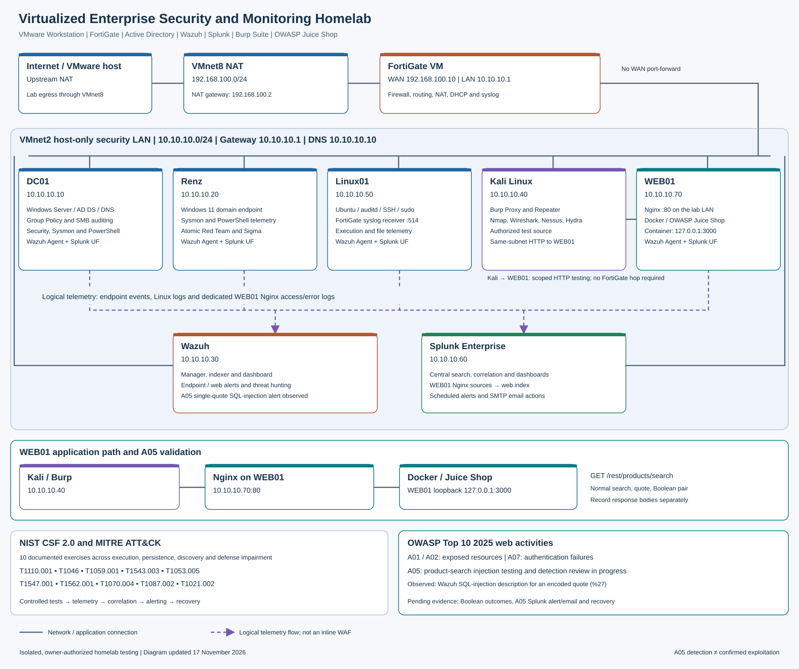
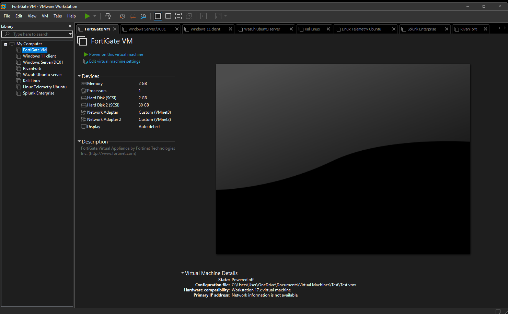

# Lab Architecture

## Network topology

[Editable SVG topology](../assets/topology.svg)

VMware Workstation provides VMnet8 NAT (`192.168.100.0/24`) and the VMnet2
host-only security LAN (`10.10.10.0/24`). FortiGate connects these networks
using WAN `192.168.100.10` and LAN `10.10.10.1`; it provides firewalling,
routing, NAT, and DHCP. Internal DNS is DC01 at `10.10.10.10`.

## Web application and monitoring paths

Kali (`10.10.10.40`) sends authorized Burp Proxy and Repeater requests to
WEB01 Nginx at `10.10.10.70:80`. Nginx proxies to Juice Shop bound to
`127.0.0.1:3000` on WEB01. No WAN port-forward exposes the web target.
Kali and WEB01 share the lab subnet; their direct traffic does not require
FortiGate routing.

WEB01's Wazuh agent and Splunk Universal Forwarder collect the dedicated
Nginx access/error logs. Wazuh is at `10.10.10.30`; Splunk Enterprise is at
`10.10.10.60`, with web telemetry in the `web` index. The Wazuh agent is
registered as `WEB01-10.10.10.70`.

The A05 activity adds SQL-injection request testing and detection review;
it does not add a network segment or an inline WAF. A Wazuh SQL-injection
alert was reported for a `%27` search request. The Boolean payloads' alert
coverage and application response comparison require separate evidence.

## VMware virtual machines

The lab contains FortiGate, DC01, the Renz Windows 11 endpoint, Wazuh,
Kali, Linux01, Splunk Enterprise, and WEB01.
