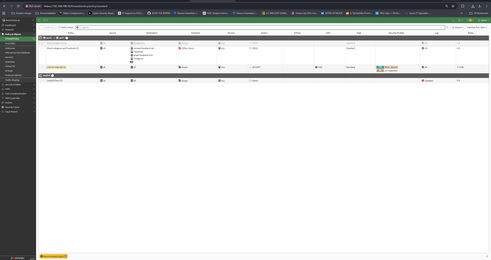
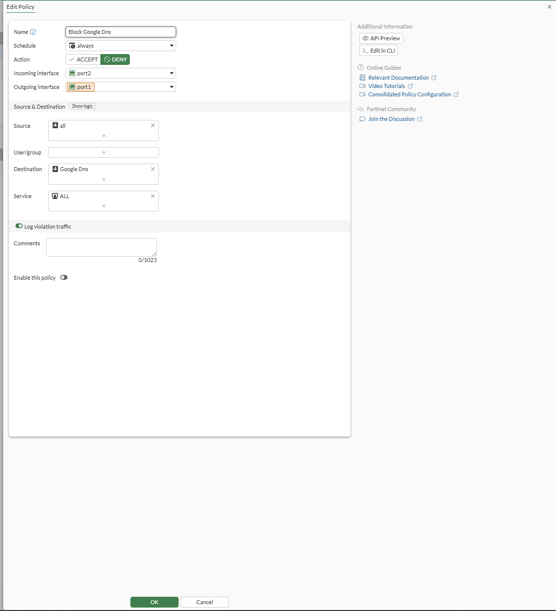
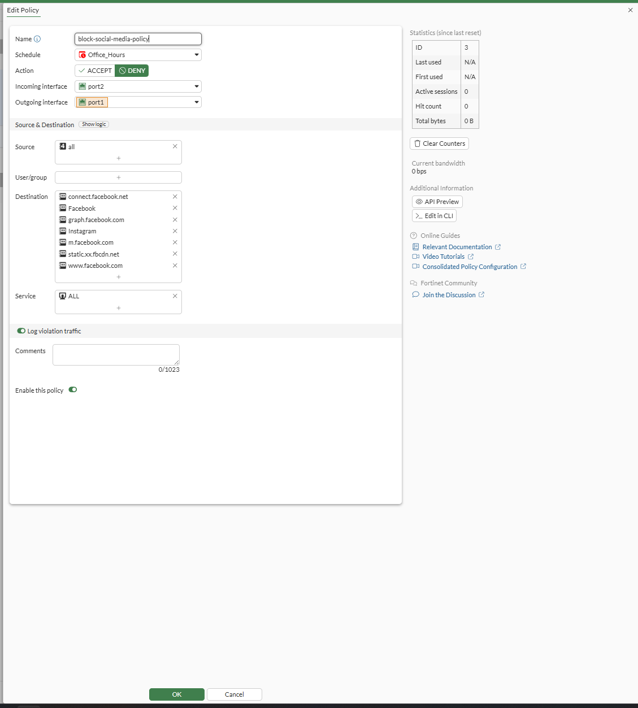
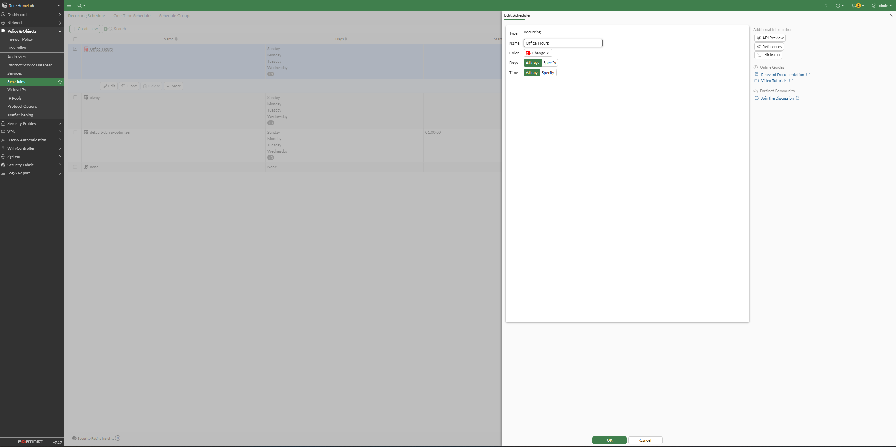
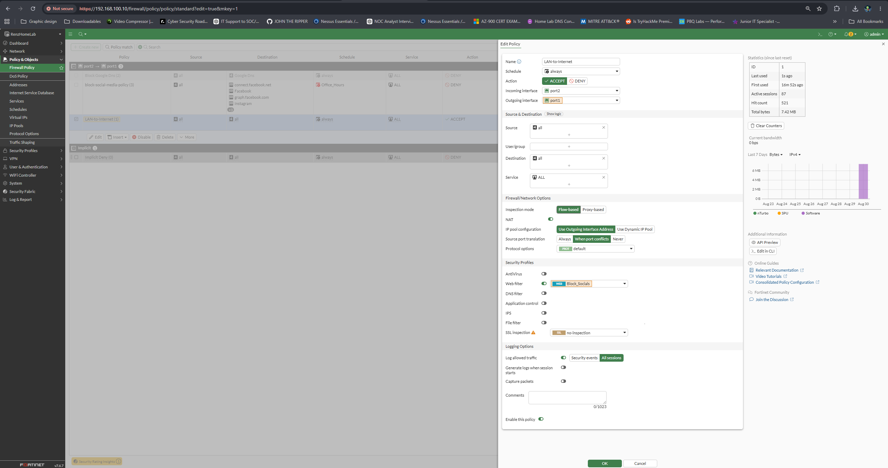
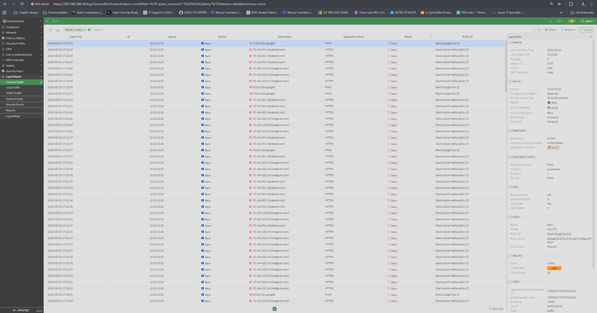
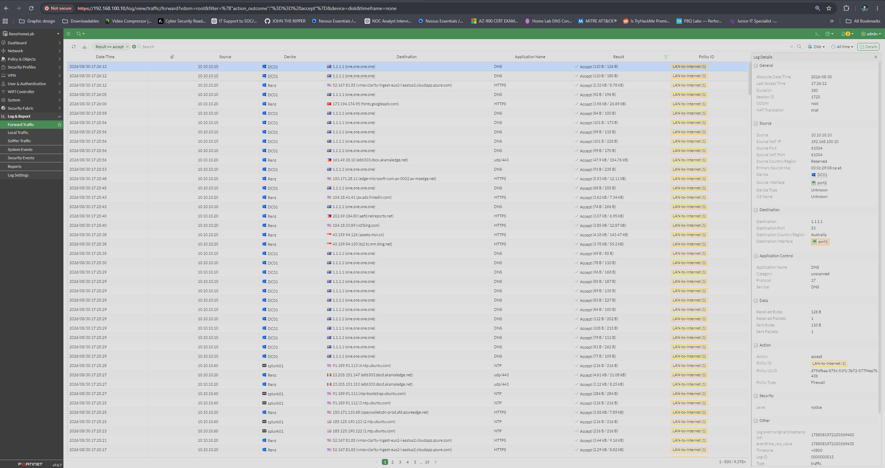

# FortiGate Firewall Policies

## Policy Order

Firewall rules are evaluated from top to bottom. The first matching rule is
applied.

## Block Google DNS

This policy prevents internal clients from communicating directly with Google
DNS servers such as `8.8.8.8`.

## Block Social Media

## Business-Hours Schedule

## LAN-to-Internet Access

## Traffic Validation

### Denied traffic

### Allowed traffic

