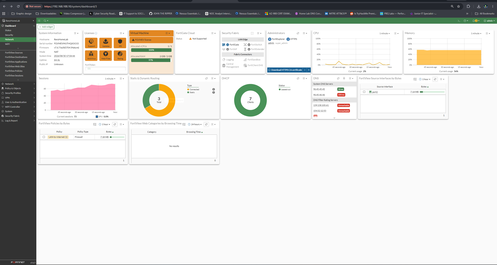
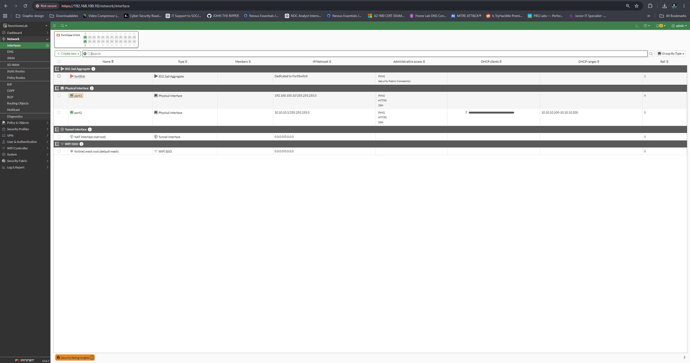
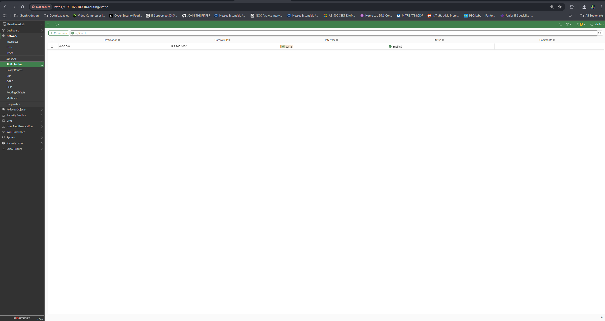
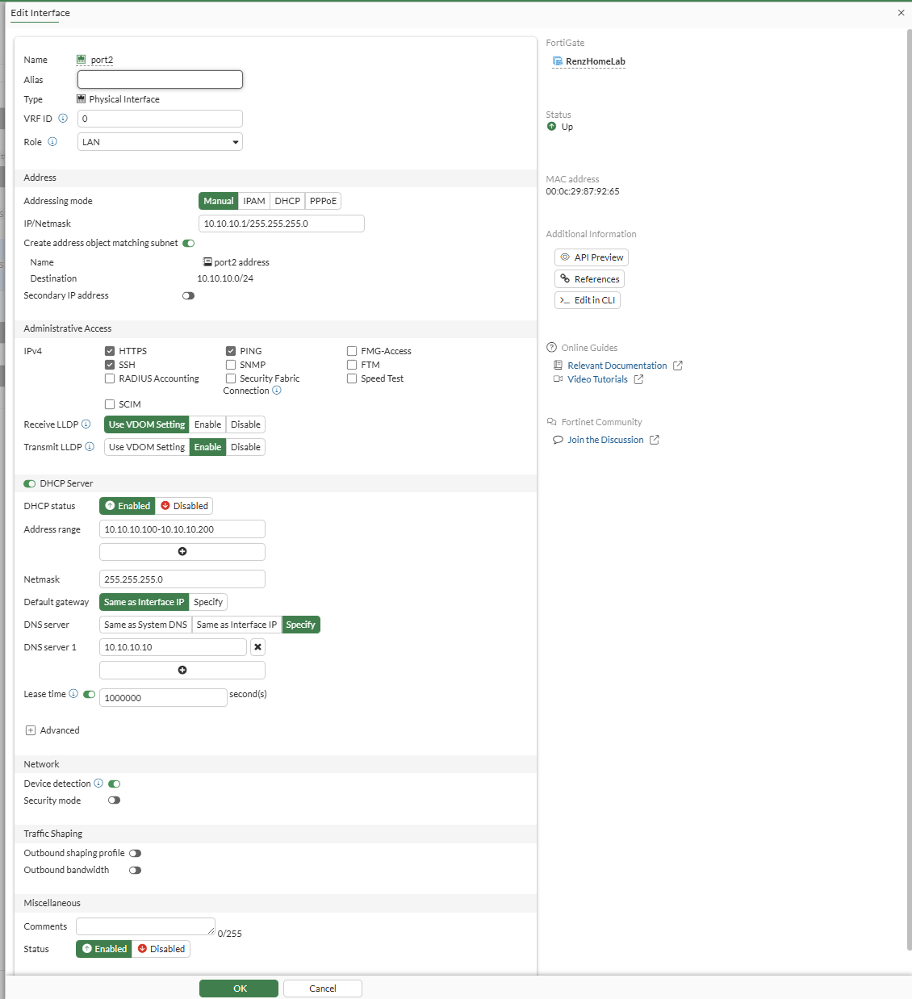
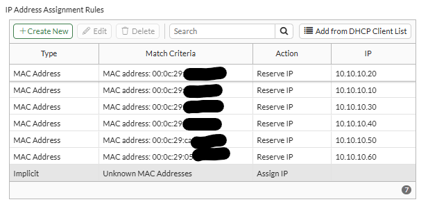

# FortiGate Configuration

## Dashboard

## Network Interfaces

- WAN interface: `port1`
- WAN address: `192.168.100.10/24`
- LAN interface: `port2`
- LAN address: `10.10.10.1/24`

## Default Route

The default route sends outbound traffic through the VMware NAT gateway at
`192.168.100.2`.

## DHCP Server

FortiGate provides DHCP services to the internal `10.10.10.0/24` network.

## DHCP Reservations

