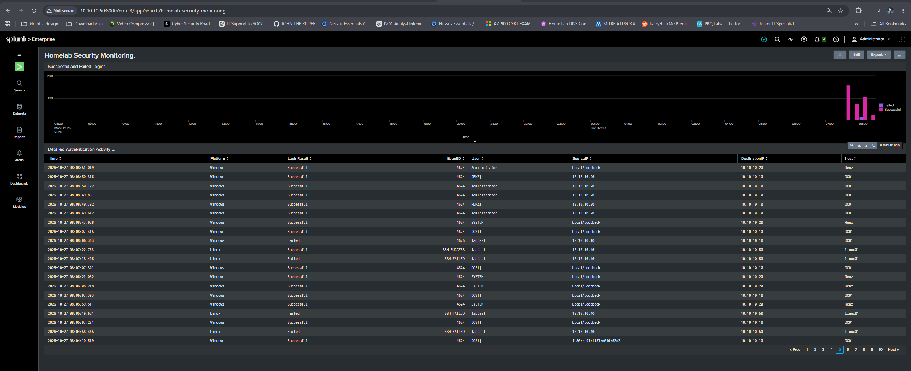

# Splunk Enterprise Configuration and Security Monitoring

## Overview

Splunk Enterprise provides centralized log collection, searching, dashboard visualization, detection and email alerting for this virtualized security homelab.

The deployment collects telemetry from:

- Windows Server Domain Controller
- Windows 11 domain client
- Ubuntu Linux server
- Sysmon and PowerShell operational logs

Splunk is used to investigate authentication activity, Active Directory changes, Windows process execution, Linux SSH activity, firewall traffic and potential brute-force attacks.

## Splunk Architecture

| Component | Host | IP address | Function |
|---|---|---:|---|
| Splunk Enterprise | Splunk Server | `10.10.10.60` | Indexing, searching, dashboards and alerts |
| Universal Forwarder | DC01 | `10.10.10.10` | Windows Server and Active Directory logs |
| Universal Forwarder | Renz | `10.10.10.20` | Windows 11 and PowerShell logs |
| Universal Forwarder | Linux01 | `10.10.10.50` | Linux authentication and FortiGate syslog |

## Data Flow

```text
DC01 10.10.10.10
    └── Windows Event Logs
            └── Splunk Universal Forwarder
                    └── TCP 9997
                            └── Splunk Enterprise 10.10.10.60

Windows 11 10.10.10.20
    └── Security, System, PowerShell and Sysmon
            └── Splunk Universal Forwarder
                    └── TCP 9997
                            └── Splunk Enterprise 10.10.10.60

Ubuntu 10.10.10.50
    └── Linux authentication logs
            └── Splunk Universal Forwarder
                    └── TCP 9997
                            └── Splunk Enterprise 10.10.10.60

```

## Splunk Enterprise Server

Splunk Enterprise is installed on Ubuntu at:

```text
/opt/splunk
```

The web interface is available at:

```text
http://10.10.10.60:8000
```

The server receives forwarded events on:

```text
TCP 9997
```

Splunk is configured as a systemd-managed service:

```bash
sudo /opt/splunk/bin/splunk enable boot-start \
  -user splunk \
  -group splunk \
  -systemd-managed 1
```

Service-management commands:

```bash
sudo systemctl start Splunkd
sudo systemctl stop Splunkd
sudo systemctl restart Splunkd
sudo systemctl status Splunkd
```

## Data Sources

The following sourcetypes and log channels are collected:

| Host | Source or sourcetype | Information collected |
|---|---|---|
| DC01 | `XmlWinEventLog:Security` | Authentication, accounts, groups and audit events |
| DC01 | `XmlWinEventLog:System` | Services and operating-system events |
| DC01 | `XmlWinEventLog:Application` | Application activity |
| DC01 | `XmlWinEventLog:DNS Server` | DNS Server events |
| DC01 | `XmlWinEventLog:Directory Service` | Active Directory events |
| Renz | `XmlWinEventLog:Security` | Windows authentication and security events |
| Renz | `XmlWinEventLog:System` | Windows services and system activity |
| Renz | `XmlWinEventLog:Application` | Application activity |
| Renz | `XmlWinEventLog:Microsoft-Windows-PowerShell/Operational` | PowerShell activity |
| Linux01 | `linux_secure` | SSH and sudo authentication |

## Windows Universal Forwarder Inputs

Example Windows inputs:

```ini
[WinEventLog://Security]
disabled = 0
renderXml = true

[WinEventLog://System]
disabled = 0
renderXml = true

[WinEventLog://Application]
disabled = 0
renderXml = true

[WinEventLog://Microsoft-Windows-PowerShell/Operational]
disabled = 0
renderXml = true

[WinEventLog://Microsoft-Windows-Sysmon/Operational]
disabled = 0
renderXml = true
```

DC01 additionally collects:

```ini
[WinEventLog://Directory Service]
disabled = 0
renderXml = true

[WinEventLog://DNS Server]
disabled = 0
renderXml = true
```

The complete sanitized example is available at:

```text
configs/splunk/inputs.conf.example
```

## Linux Universal Forwarder Inputs

Example Linux authentication input:

```ini
[monitor:///var/log/auth.log]
disabled = false
index = main
sourcetype = linux_secure
host = Linux01
```

The FortiGate log input is:

```ini
[monitor:///var/log/fortigate.log]
disabled = false
index = main
sourcetype = fortigate
host = FortiGate
```

## FortiGate Syslog Collection

FortiGate sends syslog to Ubuntu `10.10.10.50` using UDP port `514`.

Ubuntu rsyslog listens for the events and writes them to:

```text
/var/log/fortigate.log
```

Example rsyslog configuration:

```text
module(load="imudp")
input(type="imudp" port="514")

if ($fromhost-ip == "10.10.10.1") then {
    action(type="omfile" file="/var/log/fortigate.log")
    stop
}
```

The configuration is stored in:

```text
/etc/rsyslog.d/30-fortigate.conf
```

A sanitized example is available at:

```text
configs/rsyslog/30-fortigate.conf.example
```

## Log-Source Verification

The following SPL verifies which hosts are sending events:

```spl
index=* NOT index=_internal
| stats count AS Events
        latest(_time) AS LastSeen
        values(sourcetype) AS Sourcetypes
        BY host
| convert ctime(LastSeen)
| sort - Events
```

Expected hosts:

```text
DC01
Renz
Linux01
FortiGate
```


## Dashboard

The primary dashboard is named:

```text
Homelab Security Monitoring
```

The dashboard includes:

- Event volume by host
- Successful and failed logins
- Detailed authentication activity
- Potential brute-force activity
- Active Directory account changes
- Security-group membership changes
- Account lockouts
- PowerShell activity
- Windows process creation
- Linux SSH and sudo activity
- FortiGate allowed and denied traffic
- Log-source health


## Authentication Monitoring

Windows authentication is identified using:

| Event ID | Description |
|---:|---|
| `4624` | Successful Windows login |
| `4625` | Failed Windows login |
| `4740` | Domain account locked out |

Linux authentication is identified from:

```text
Accepted password
Accepted publickey
Failed password
```

Linux events are normalized as:

```text
SSH_SUCCESS
SSH_FAILED
```

The detailed authentication panel displays:

```text
Time
Platform
Login result
Event ID
Username
Source IP
Destination IP
Destination host
```



## Brute-Force Detection

The brute-force detection identifies five or more failed authentication attempts from the same source within five minutes.

The detection includes:

- Windows and Linux platform
- Source IP address
- Destination IP address
- Target username
- Destination host
- Failed-attempt count
- First and latest occurrence

A controlled test was performed from Kali Linux at `10.10.10.40` against the Ubuntu SSH service at `10.10.10.50`.

The fictional account used for testing was:

```text
labtest
```


## Brute-Force Alert

The scheduled alert is configured as:

| Setting | Value |
|---|---|
| Alert name | Multiple Failed Login Attempts |
| Alert type | Scheduled |
| Schedule | Every minute |
| Search window | Last five minutes |
| Trigger | Number of results greater than zero |
| Failed-attempt threshold | Five |
| Throttle | Ten minutes |
| Alert action | Send email |

The email includes the detection results and a link to the Splunk search.


Email addresses, SMTP credentials and Google app passwords are excluded from this repository.

## Active Directory Monitoring

### Account-management events

| Event ID | Description |
|---:|---|
| `4720` | User account created |
| `4722` | User account enabled |
| `4725` | User account disabled |
| `4726` | User account deleted |
| `4738` | User account modified |


### Group-membership events

| Event ID | Description |
|---:|---|
| `4728` | Member added to a global security group |
| `4729` | Member removed from a global security group |
| `4732` | Member added to a local security group |
| `4733` | Member removed from a local security group |
| `4756` | Member added to a universal security group |
| `4757` | Member removed from a universal security group |

The fictional group used for controlled testing was:

```text
SOC-Lab-Analysts
```

The `labtest` account was added to and removed from the group.


### Account lockout

A domain account-lockout policy was configured with:

```text
Threshold: 5 failed attempts
Lockout duration: 5 minutes
Counter reset: 5 minutes
```

The controlled test generated Windows event `4740`.


## PowerShell Monitoring

PowerShell Operational events are collected from Windows 11.

Important events include:

| Event ID | Description |
|---:|---|
| `4103` | PowerShell module logging |
| `4104` | PowerShell script-block logging |

Keywords investigated include:

```text
EncodedCommand
Invoke-Expression
DownloadString
FromBase64String
Net.WebClient
Invoke-WebRequest
```


Keyword matches require investigation because legitimate administrative activity can produce similar events.

## Windows Process and Service Monitoring

Important Windows events include:

| Event ID | Description |
|---:|---|
| `4688` | New process created |
| `4697` | Service installed |
| `7045` | New Windows service installed |
| `4698` | Scheduled task created |
| `4702` | Scheduled task updated |
| `1102` | Security audit log cleared |

Suspicious or dual-use processes investigated include:

```text
powershell.exe
cmd.exe
wscript.exe
cscript.exe
rundll32.exe
regsvr32.exe
certutil.exe
```

## Linux Monitoring

Linux monitoring covers:

- Successful SSH login
- Failed SSH login
- Repeated SSH failures
- Sudo activity
- Failed sudo authentication
- User and group changes


## FortiGate Monitoring

FortiGate monitoring includes:

- Allowed connections
- Denied connections
- Source and destination IP addresses
- Source and destination ports
- Firewall policy IDs
- Services
- Traffic volume
- Administrative and system activity


## Log-Source Health

The log-source health panel identifies endpoints that have stopped sending events.

The panel tracks:

- Hostname
- Event count
- Last-seen time
- Minutes since the last event
- Reporting status


## Detection Searches

Sanitized SPL searches are stored in:

```text
configs/splunk/detection-searches.md
```

The file includes searches for:

- Successful and failed authentication
- Brute-force detection
- Account lockouts
- Active Directory account changes
- Group-membership changes
- PowerShell activity
- Process creation
- New services
- Linux SSH and sudo activity
- Log-source health

Scheduled alert searches are stored in:

```text
configs/splunk/alert-searches.md
```

## Testing Methodology

All detection testing was performed inside the isolated homelab.

Controlled activities included:

1. Successful Windows domain authentication
2. Failed Windows authentication
3. Successful Linux SSH authentication
4. Failed Linux SSH authentication
5. Controlled SSH brute-force simulation
6. Domain account lockout
7. Security-group membership modification
8. Splunk email-notification testing

No testing was performed against systems outside the authorized lab environment.

## Security Considerations

The following information is excluded from the repository:

- Splunk administrator passwords
- Gmail passwords
- Google app passwords
- SMTP credentials
- Wazuh enrollment passwords
- FortiGate password hashes
- API tokens
- Private keys
- Real personal information

Screenshots use fictional accounts and sanitized email addresses.

## Skills Demonstrated

This implementation demonstrates:

- Centralized security logging
- Windows Event Log analysis
- Linux authentication analysis
- Firewall syslog ingestion
- SPL development
- Detection engineering
- Dashboard creation
- Scheduled alerting
- Email notification integration
- Authentication investigation
- Active Directory monitoring
- Log-source health monitoring
- Evidence collection and documentation

## Disclaimer

This project was created for educational and defensive security purposes in an isolated, authorized homelab. Detection tests were performed only against systems owned and controlled by the project author.
