# NIST CSF 2.0 and MITRE ATT&CK Network Service Discovery Exercise

## Exercise Summary

This exercise simulated controlled network service discovery from Kali Linux against an Ubuntu endpoint and FortiGate firewall inside an authorized virtualized security homelab.

Nmap was used to identify open, closed and filtered TCP ports. Network activity was captured using tcpdump and Wireshark, recorded in Linux kernel logs, forwarded to Wazuh and Splunk, and used to trigger a Splunk alert with an SMTP email notification.

The activity was mapped to MITRE ATT&CK technique **T1046 - Network Service Discovery** and documented using the NIST Cybersecurity Framework 2.0 functions: Govern, Identify, Protect, Detect, Respond and Recover.

---

## Exercise Information

| Field | Value |
|---|---|
| Exercise | Network Service Discovery |
| Date | [ENTER DATE] |
| Tester | Renz Nicole M. Aguilar |
| MITRE tactic | Discovery |
| MITRE technique | T1046 - Network Service Discovery |
| Source system | Kali Linux |
| Source IP | `10.10.10.40` |
| Primary target | Linux01 |
| Primary target IP | `10.10.10.50` |
| Firewall target | FortiGate |
| Firewall IP | `10.10.10.1` |
| Detection tools | Linux logging, Wazuh and Splunk |
| Network evidence | Nmap, tcpdump and Wireshark |
| Alert method | Splunk scheduled alert and SMTP email |
| Overall status | [SUCCESSFUL / PARTIALLY SUCCESSFUL] |

---

## Objectives

The objectives were to:

1. Perform authorized network service discovery using Nmap.
2. Identify TCP services exposed by Linux01.
3. Capture the scan using tcpdump and Wireshark.
4. Record scan packets in Linux kernel logs.
5. Forward the resulting events to Splunk and Wazuh.
6. Identify the source and destination IP addresses.
7. Count the number of unique destination ports.
8. Generate a Splunk T1046 alert.
9. Receive an SMTP email notification.
10. Simulate source-IP containment.
11. Remove containment and confirm normal service recovery.
12. Document the exercise using NIST CSF 2.0 and MITRE ATT&CK.

---

## Scope and Authorization

This exercise was performed only against privately owned systems inside the virtualized homelab.

Authorized systems:

| System | IP address | Role |
|---|---:|---|
| Kali Linux | `10.10.10.40` | Authorized scanning system |
| Linux01 | `10.10.10.50` | Primary scan target |
| FortiGate | `10.10.10.1` | Firewall and local-service scan target |
| Wazuh | `10.10.10.30` | SIEM and endpoint monitoring |
| Splunk Enterprise | `10.10.10.60` | Search, dashboard and alerting platform |

The scan was limited to selected TCP ports. No exploitation, denial-of-service activity or unauthorized targets were included.

---

## Topology Consideration

Kali and Linux01 are connected to the same `10.10.10.0/24` VMware virtual LAN.

Traffic between `10.10.10.40` and `10.10.10.50` travels directly through the VMware virtual switch and does not pass through FortiGate. Therefore, the Linux01 scan produced Linux, Wazuh, Splunk and packet-capture evidence.

FortiGate evidence was generated separately by scanning the FortiGate LAN interface at `10.10.10.1`. This traffic appeared as local-in traffic because FortiGate itself was the destination.

---

## MITRE ATT&CK Mapping

| Field | Mapping |
|---|---|
| Tactic | Discovery |
| Technique | T1046 - Network Service Discovery |
| Simulated behavior | TCP port and service enumeration |
| Tool | Nmap |
| Source | Kali Linux `10.10.10.40` |
| Destination | Linux01 `10.10.10.50` |
| Additional destination | FortiGate `10.10.10.1` |
| Data sources | Network traffic, firewall logs and Linux kernel logs |

Reference: [MITRE ATT&CK T1046](https://attack.mitre.org/techniques/T1046/)

---

## NIST CSF 2.0 Mapping

### Govern

- The exercise was authorized and limited to the homelab.
- The permitted source and destination systems were documented.
- Selected ports and scan intensity were defined before testing.
- Destructive scripts and exploitation were excluded.

### Identify

The following assets and risks were identified:

| Asset | Risk |
|---|---|
| Linux01 | Exposure of unnecessary network services |
| FortiGate | Exposure of administrative services |
| SSH TCP/22 | Remote-access exposure |
| Splunk and Wazuh | Missing or incomplete network-scan telemetry |
| VMware LAN | Limited visibility into same-subnet east-west traffic |

### Protect

- FortiGate provided network segmentation and access control.
- Only necessary services were expected to be enabled.
- Linux firewall rules were available for containment.
- Wazuh and Splunk agents were verified before testing.
- The scan was restricted to selected TCP ports.

### Detect

The following detection sources were used:

- Nmap output
- tcpdump packet capture
- Wireshark analysis
- Linux kernel logs
- Wazuh events
- Splunk searches
- Splunk scheduled alert
- SMTP email notification
- FortiGate Local Traffic logs

### Respond

Response activities included:

1. Validating that the scanner was an authorized lab system.
2. Identifying the source and destination IP addresses.
3. Identifying the destination ports.
4. Comparing Nmap results with listening services.
5. Temporarily blocking the scanner IP.
6. Verifying that scanned ports became filtered.

### Recover

Recovery activities included:

1. Removing the temporary containment rule.
2. Removing the temporary scan-logging rule.
3. Confirming that SSH TCP/22 was accessible again.
4. Confirming Wazuh and Splunk service health.
5. Preserving the evidence and investigation results.

---

## Preparation

The services listening on Linux01 were checked using:

```bash
sudo ss -lntup
```

A temporary logging rule was added:

```bash
sudo iptables -I INPUT 1 \
-s 10.10.10.40 \
-p tcp --syn \
-m limit --limit 30/min --limit-burst 50 \
-j LOG --log-prefix "NMAP_SCAN " --log-level 4
```

The rule logged TCP SYN packets from Kali without blocking them.

---

## Baseline

Before the scan, Splunk was searched for existing scan events:

```spl
index=* host="Linux01" sourcetype="linux:kern" "NMAP_SCAN"
| table _time host source _raw
| sort -_time
```

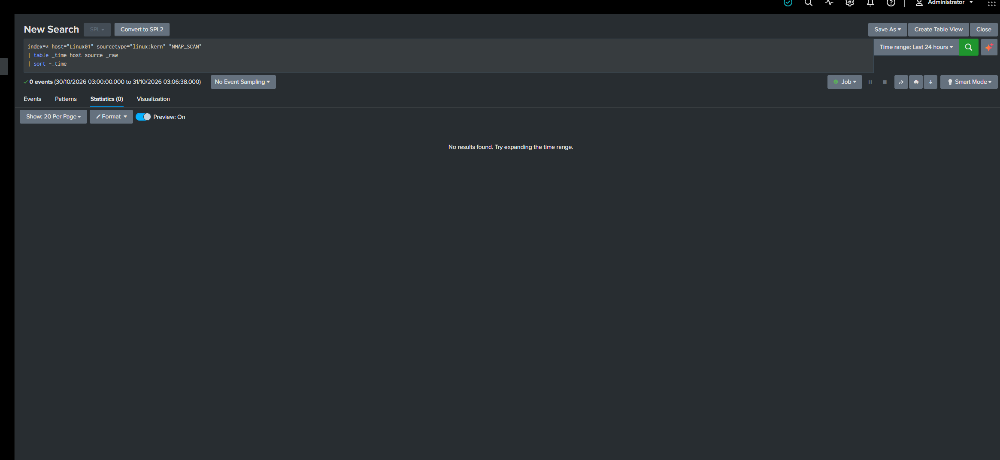

---

## Nmap Test

The following controlled scan was executed from Kali:

```bash
sudo nmap -sS -sV --version-light -T3 \
-p 21,22,23,25,53,80,110,139,443,445,514,8000,8080,9997 \
-oA T1046-linux01 \
10.10.10.50
```

| Option | Purpose |
|---|---|
| `-sS` | TCP SYN scan |
| `-sV` | Service-version detection |
| `--version-light` | Reduced version-detection intensity |
| `-T3` | Normal timing |
| `-p` | Limits the scan to selected ports |
| `-oA` | Saves normal, grepable and XML results |

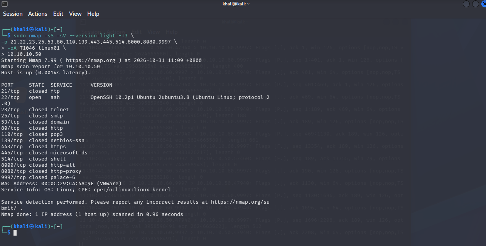

---

## Packet Capture

The traffic was captured using:

```bash
sudo tcpdump -i any -nn -U \
-w "$HOME/T1046-test/T1046-linux01.pcap" \
host 10.10.10.50
```

The following Wireshark display filter identified initial SYN packets:

```text
ip.src == 10.10.10.40 &&
ip.dst == 10.10.10.50 &&
tcp.flags.syn == 1 &&
tcp.flags.ack == 0
```

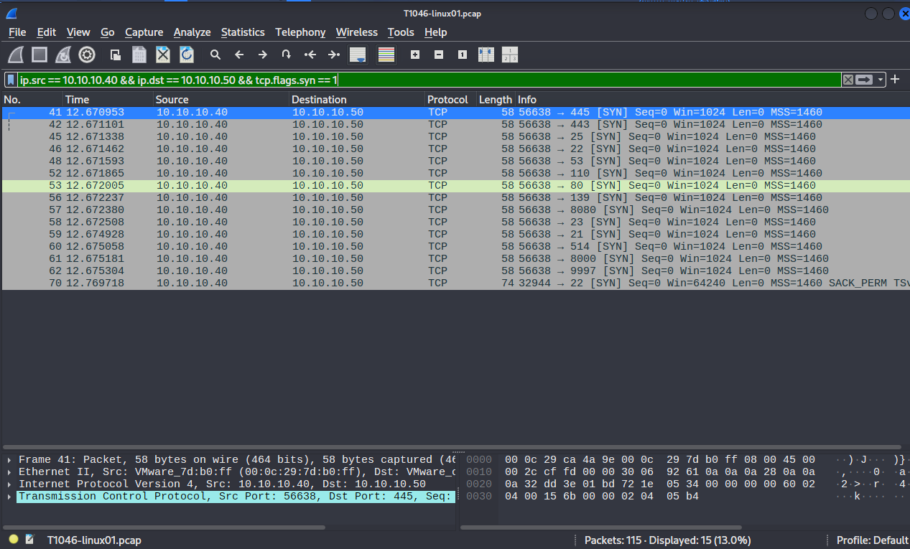

---

## Linux Kernel Evidence

The Linux events were reviewed using:

```bash
sudo journalctl -k --since "10 minutes ago" |
grep "NMAP_SCAN"
```

The events included:

```text
SRC=10.10.10.40
DST=10.10.10.50
PROTO=TCP
DPT=<destination port>
```

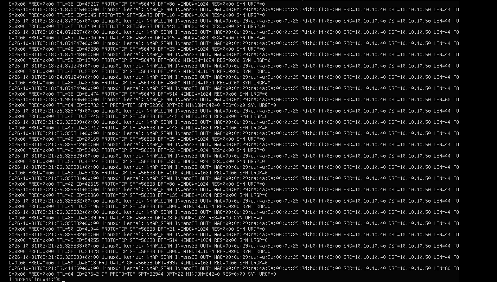

---

## Splunk Investigation

Splunk extracted the following information:

| Field | Result |
|---|---|
| Source IP | `10.10.10.40` |
| Destination IP | `10.10.10.50` |
| Protocol | TCP |
| Connection attempts | [ENTER COUNT] |
| Unique destination ports | [ENTER COUNT] |
| Scanned ports | [ENTER PORTS] |
| First observed | [ENTER TIME] |
| Last observed | [ENTER TIME] |

The searches used for this investigation are stored in:

```text
splunk-searches.spl
```

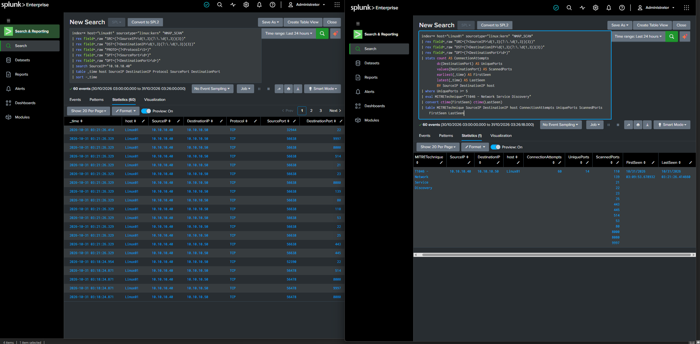

---

## Wazuh Investigation

Wazuh was searched for Linux01 events containing the `NMAP_SCAN` prefix and Kali source IP.

The queries are stored in:

```text
wazuh-queries.txt
```

Wazuh findings:

| Field | Result |
|---|---|
| Agent | `UBUNTU-10.10.10.50` |
| Source IP | `10.10.10.40` |
| Rule ID | [ENTER RULE ID] |
| Rule level | [ENTER LEVEL] |
| Description | [ENTER DESCRIPTION] |

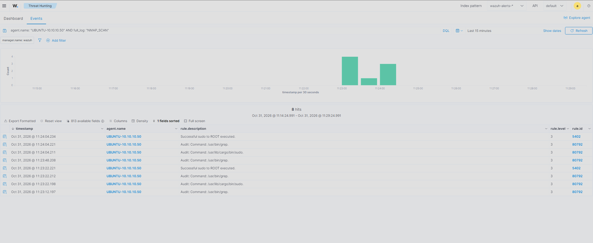

---

## FortiGate Evidence

Because same-subnet traffic did not pass through FortiGate, a separate scan was performed against the FortiGate LAN interface:

```bash
sudo nmap -sS -sV --version-light -T3 \
-p 22,53,80,443,541,8008,8013 \
10.10.10.1
```

FortiGate Local Traffic was filtered using:

```text
Source IP: 10.10.10.40
Destination IP: 10.10.10.1
```

The results showed Kali connecting to multiple FortiGate services and destination ports.

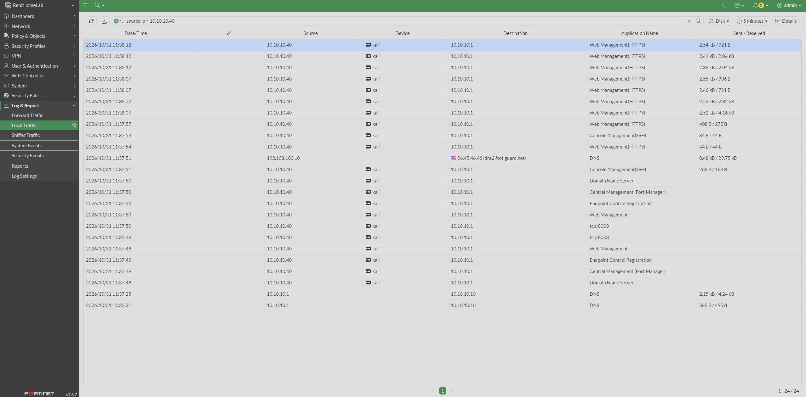

---

## Service Validation

Nmap results were compared with services listening on Linux01:

```bash
sudo ss -lntup
```

Open ports reported by Nmap corresponded to services listening on the target.

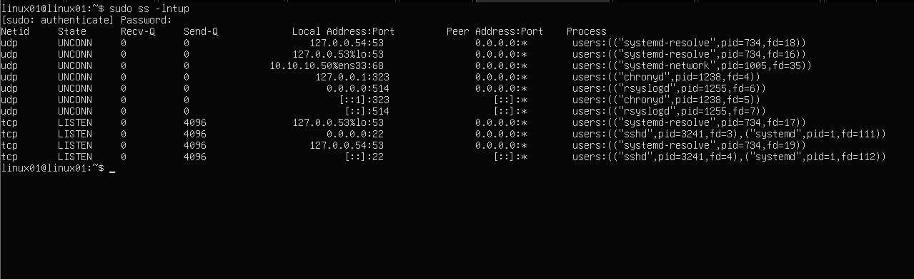

---

## Splunk Alert

A scheduled Splunk alert was created with the following condition:

```text
One source contacts five or more unique destination ports within five minutes.
```

Alert configuration:

| Setting | Value |
|---|---|
| Alert name | Network Service Discovery Detected |
| MITRE technique | T1046 |
| Schedule | Every minute |
| Search window | Last five minutes |
| Threshold | Five unique destination ports |
| Severity | Medium |
| Throttle | Ten minutes |
| Actions | Triggered Alerts and Send Email |

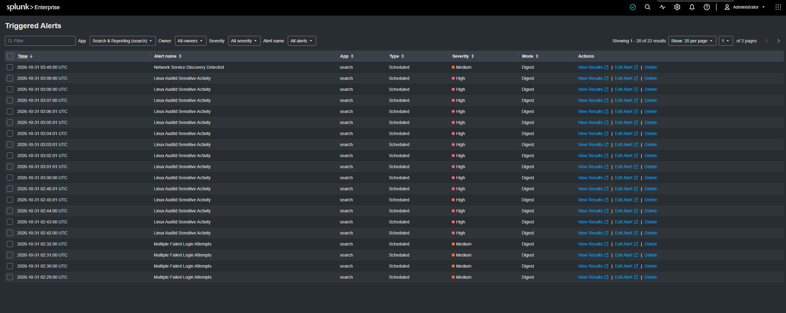

---

## Email Notification

The email notification contained:

- Severity
- MITRE technique
- Source IP
- Destination IP
- Protocol
- Connection-attempt count
- Unique-port count
- Scanned ports
- Splunk investigation link

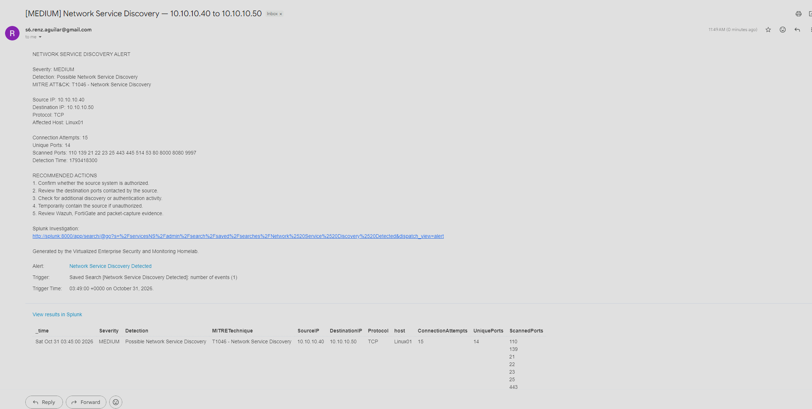

---

## Containment

Kali was temporarily blocked on Linux01:

```bash
sudo iptables -I INPUT 1 -s 10.10.10.40 -j DROP
```

A validation scan showed:

```text
22/tcp  filtered  ssh
80/tcp  filtered  http
443/tcp filtered  https
```

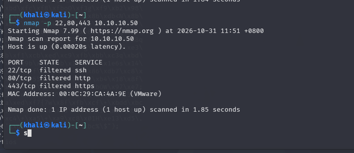

---

## Recovery

The containment rule was removed:

```bash
sudo iptables -D INPUT -s 10.10.10.40 -j DROP
```

A recovery scan confirmed:

```text
22/tcp open ssh
```

Ports without active services returned to their normal closed state.

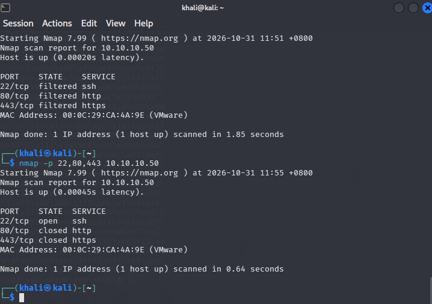

---

## Results

| Validation requirement | Result |
|---|---|
| Nmap scan completed | [PASS / FAIL] |
| Nmap output files saved | [PASS / FAIL] |
| Packet capture created | [PASS / FAIL] |
| Linux logged scan packets | [PASS / FAIL] |
| Splunk received kernel events | [PASS / FAIL] |
| Splunk extracted source and destination IPs | [PASS / FAIL] |
| Wazuh received scan events | [PASS / FAIL] |
| FortiGate Local Traffic evidence collected | [PASS / FAIL] |
| Splunk alert triggered | [PASS / FAIL] |
| Email notification received | [PASS / FAIL] |
| Source containment worked | [PASS / FAIL] |
| Normal connectivity was restored | [PASS / FAIL] |

---

## Problems Encountered

### Packet capture path

The first packet capture printed packets to the terminal but did not create a PCAP file because the `-w` option was not included correctly.

The issue was corrected by using:

```bash
sudo tcpdump -i any -nn -U \
-w "$HOME/T1046-test/T1046-linux01.pcap" \
host 10.10.10.50
```

### Incorrect home-directory assumption

The Kali username was `khali`, so the correct home directory was `/home/khali`, not `/home/kali`.

Using `$HOME` prevented further path errors.

### FortiGate filtering

Typing `source ip = 10.10.10.40` into the general search bar did not create a structured filter. A Source IP filter was created using the FortiGate filter control.

---

## Lessons Learned

1. Same-subnet traffic does not normally pass through the default gateway.
2. FortiGate Forward Traffic cannot be used as evidence for traffic that never traverses FortiGate.
3. Scanning FortiGate itself generates local-in rather than forward traffic.
4. Nmap results should be compared with actual listening services.
5. Packet capture provides independent evidence of network behavior.
6. Linux firewall logging can provide host-level scan visibility.
7. Multiple destination ports within a short period can indicate service discovery.
8. Alert throttling prevents repeated notifications for the same scan.
9. Containment must be followed by recovery validation.
10. Explicit file paths prevent evidence from being saved in unexpected locations.

---

## Recommended Improvements

- Create a custom Wazuh rule mapped to T1046.
- Add a permanent Splunk T1046 dashboard panel.
- Create separate network segments so east-west traffic passes through FortiGate.
- Deploy an IDS such as Suricata for network-based scan detection.
- Add source and destination asset enrichment.
- Create different thresholds for servers, workstations and firewalls.
- Detect one source scanning multiple hosts.
- Compare SYN scans with TCP connect and UDP scans.
- Measure detection and response times.
- Document authorized vulnerability-scanning systems in a lookup.

---

## Overall Result

The T1046 Network Service Discovery exercise was completed successfully.

A controlled Nmap scan was performed from Kali Linux at `10.10.10.40` against Linux01 at `10.10.10.50`. The scan generated Nmap, packet-capture, Linux kernel, Wazuh and Splunk evidence.

Splunk identified one source contacting multiple destination ports and generated an alert with an SMTP email notification. A temporary firewall rule successfully contained the source, causing the tested ports to appear filtered. The rule was subsequently removed, and normal SSH connectivity was restored.

The exercise validated the Govern, Identify, Protect, Detect, Respond and Recover functions of NIST CSF 2.0 and MITRE ATT&CK technique T1046.

---

## Evidence Files

```text
screenshots/
├── 01-before-scan.png
├── 02-nmap-service-scan.png
├── 03-wireshark-syn-packets.png
├── 04-linux-kernel-logs.png
├── 05-splunk-scan-events.png
├── 06-wazuh-scan-detection.png
├── 07-fortigate-local-scan.png
├── 08-services-validated.png
├── 09-splunk-t1046-alert.png
├── 10-t1046-email-alert.png
├── 11-source-contained.png
└── 12-connectivity-recovered.png
```

---

## References

- [NIST Cybersecurity Framework 2.0](https://www.nist.gov/cyberframework)
- [NIST SP 800-61 Revision 3](https://csrc.nist.gov/pubs/sp/800/61/r3/final)
- [MITRE ATT&CK T1046 Network Service Discovery](https://attack.mitre.org/techniques/T1046/)
- [Nmap Service and Version Detection](https://nmap.org/book/man-version-detection.html)
